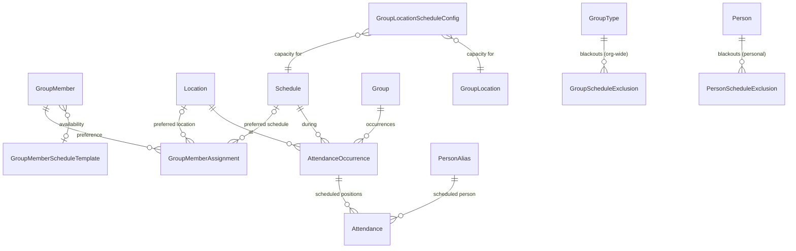

# Group Scheduling

## Overview

Group Scheduling is the volunteer scheduling system for Groups whose `GroupType.IsSchedulingEnabled` is true: typical for serving teams. The administrator-facing block is **Group Scheduler**; the volunteer-facing self-service block is **Schedule Toolbox**. Both work from `Attendance`: one row for each person at each occurrence, which is a group, location, schedule, and date. `GroupMemberAssignment` holds each member's preferred schedule and location, and Auto Schedule uses it to decide who to place.

## Mental Model

A scheduled position is **one person at one occurrence**. The occurrence is an `AttendanceOccurrence`, identified by `(Group, Location, Schedule, OccurrenceDate)`. The person's row on it is an `Attendance` with `RequestedToAttend = true`. The same volunteer has one `Attendance` row for each occurrence they are scheduled for, across services and weeks. The row carries the scheduling state (pending, confirmed, declined) and the per-occurrence notification flags.

The inputs that decide who gets scheduled are separate from the schedule itself:

- **Availability** (the cadence a volunteer says they can serve) lives on `GroupMemberScheduleTemplate`. A template is a recurring pattern, like "Every Sunday Morning". A `GroupMember` references at most one template via `GroupMember.ScheduleTemplateId`.
- **Preferences** (which schedule, which location, or both, the volunteer prefers) live on `GroupMemberAssignment`. A preference row covers every recurrence of the schedule it references. It is not a scheduled position: nobody is on the schedule until an `Attendance` row exists.

Sign-Up Groups reuse `GroupMemberAssignment` with a different meaning: there, a row is the member's slot on a project (location and schedule). This doc covers group scheduling only.

Capacity comes from `GroupLocationScheduleConfig`: a composite-key row per (location, schedule) pair holding `MinimumCapacity`, `DesiredCapacity`, `MaximumCapacity`. The Scheduler renders cells colored by how full each capacity bucket is.

Exclusions are two-tier. **Group-level exclusions** are GroupType-scoped blackouts (`GroupScheduleExclusion`); a holiday week applies to every Group of the type. **Person-level exclusions** are individual blackouts (`PersonScheduleExclusion`), optionally narrowed to a single Group, with a self-reference that lets a parent mark an entire family unavailable in one operation.

## What You Need to Know

**Sign-up commits on explicit Save.** The Schedule Toolbox sign-up flow does not auto-write when a volunteer checks an occurrence. The volunteer checks one or more occurrences, picks a location if there are multiple options, and explicitly clicks Save. This is intentional: a volunteer browsing openings should be able to back out without committing, and the Save step is the consent surface for the confirmation email that follows. The block partial that drives this is [signUpOccurrence.partial.obs](../../Rock.JavaScript.Obsidian.Blocks/src/Group/Scheduling/GroupScheduleToolbox/signUpOccurrence.partial.obs). Custom self-service flows that want different commit semantics need their own block.

**Warning-state members are eligible to schedule.** Group Requirement state matters here: members in `MeetsWithWarning` (e.g., a soon-expiring background check) are still eligible. Only `NotMet` blocks scheduling. The Scheduler block treated Warning as ineligible until commit `78e21f1ed0` fixed it. See [group-requirements.md](group-requirements.md).

**One `Attendance` row per person per occurrence; one preference row covers every recurrence.** Each scheduled position is its own `Attendance` row on an `AttendanceOccurrence`, and that row holds the RSVP state and the `ScheduleConfirmationSent` / `ScheduleReminderSent` flags for that one occurrence. A `GroupMemberAssignment` preference row is not per occurrence: one row for "prefers the 9am service" applies to every 9am occurrence.

**Notification windows are measured from "today" when the job runs, not from occurrence time.** `SendGroupScheduleNotifications` sends to `Attendance` rows whose occurrence date is within the offset window (`ScheduleConfirmationEmailOffsetDays` for confirmations, `ScheduleReminderEmailOffsetDays` for reminders) and whose flag is not yet set. An offset of 0 sends the reminder on the day of the occurrence. The job skips occurrences whose `StartDateTime` has already passed, so a reminder is never sent after the service has started. A per-member `ScheduleReminderEmailOffsetDays` of -1 means "do not send a reminder".

**Capacity is advisory in the UI but not enforced server-side.** Custom block actions or API calls can schedule people above `MaximumCapacity`. The block UI is the enforcement point. Bulk operations or automation that bypass the block need to enforce capacity themselves.

**`PersonScheduleExclusion.ParentPersonScheduleExclusionId` self-reference is a UI helper.** A "for my whole family" toggle in the Toolbox creates one parent row plus child rows for each family member. Cleanup of children is handled by the UI flows; raw SQL deletes of the parent do not cascade unless the FK is configured for it. Verify on your version.

**Multi-Group multi-week scheduler views can be slow.** The performance fix in commit `49530db1e1` reduced redundant queries, but the scheduler still scales with `(groups × weeks × volunteers)`. Narrow the date range or Group set when possible.

**The "Disallow Group Selection If Specified" block setting locks the Group picker only when one or more Groups are passed in the URL.** The setting was previously ignored when more than one Group was passed; commit `60924b0e17` fixed it.

**A Group can hold its own inline Schedule via `Group.ScheduleId`.** This is separate from the `Schedule` rows attached to `GroupLocation`s. The inline schedule is the Group's "primary" schedule and comes in three flavors: **Custom** (free-form iCalendar), **Weekly** (day-of-week + time-of-day), or **Named** (a reference to a shared `Schedule` row). Editing happens in the Group Detail block's Schedule section. See "Inline Schedule Lifecycle" in Technical Reference for the create / reuse / cleanup rules — the most important one is that flipping between Custom and Weekly reuses the existing inline `Schedule` row so `ScheduleId` stays stable, but flipping to or from Named never overwrites the named schedule (corruption guard).

## Common Scenarios

**"Schedule volunteers for the next four weeks of Sunday services."** Open the Group Scheduler with the relevant Group and a four-week date range. The block resolves `GroupLocation`s, their `Schedule`s, and per-pair `GroupLocationScheduleConfig` capacity. Drag eligible volunteers into cells; each drop creates a pending `Attendance` row via `ScheduledPersonAddPending`. The confirmation email goes out when `SendGroupScheduleNotifications` runs inside the confirmation window, or right away if the scheduler uses the block's send confirmations action.

**"Volunteer wants to mark themselves unavailable for two weeks."** Toolbox -> Schedule Unavailability. Creates one `PersonScheduleExclusion` row. The "for my whole family" toggle creates additional child rows.

**"Volunteer wants to sign up for an additional service."** Toolbox -> Sign Up for Additional Times. Volunteer checks occurrences, picks a location if needed, clicks Save. Each checked occurrence becomes an `Attendance` row: the block calls `ScheduledPersonAddPending`, then confirms the row in the same save because the volunteer scheduled themselves. Save is explicit; the volunteer can back out without committing.

**"Block out a holiday week for every Group of a type."** Add a `GroupScheduleExclusion` row to the GroupType with the date range. Every Group of the type honors it on the next scheduler render.

**"Volunteer is going to be reliably available every Sunday at 9am."** Set the volunteer's `GroupMember.ScheduleTemplateId` to a template bound to the 9am Schedule, plus `ScheduleStartDate` for when the pattern starts. The Scheduler will surface the volunteer for matching occurrences.

## Key Architectural Decisions

### Scheduled positions are per-occurrence `Attendance` rows

Scheduling reuses the same `Attendance` and `AttendanceOccurrence` tables that record presence. A scheduled position, its RSVP, its notification flags, and later its check-in all live on one row, so "who was scheduled" and "who showed up" can be compared without a join to a separate table.

### Templates and preferences are inputs, `Attendance` is the schedule

`GroupMemberScheduleTemplate` says "I can be scheduled at this cadence". `GroupMemberAssignment` records a preferred schedule and location, which Auto Schedule uses. Neither puts anyone on the schedule. The Scheduler (manually or through Auto Schedule) and the Toolbox sign-up write `Attendance` rows.

### Two-tier exclusions

GroupType-level for "the building is closed for Christmas". Person-level for "I am out of town that week". The Scheduler honors both in the same eligibility check. Person-level supports family rollup so parents do not have to mark four kids individually.

### Sign-up commits on explicit Save

The Toolbox sign-up flow requires an explicit Save click after the volunteer selects occurrences. Auto-on-check would commit unwanted sign-ups and send confirmation emails the volunteer never intended; the Save step is the consent surface.

## Considered but Rejected

### Auto-blocking volunteers in Warning requirement state
Rejected (commit `78e21f1ed0`). Warning means "approaching non-compliance", not "non-compliant". Blocking schedules for Warnings produced false negatives where a volunteer with a soon-expiring background check could not be scheduled for next Sunday.

### Auto-saving Toolbox sign-ups on checkbox change
Rejected. Volunteers should be able to browse openings without committing, and the Save click is the consent surface for the confirmation email. Auto-save also produces a poor UX when a volunteer checks several boxes intending to commit them as a batch.

## Technical Reference

### Data Model

`Attendance` ([Rock/Model/Event/Attendance/Attendance.cs](../../Rock/Model/Event/Attendance/Attendance.cs)) is the scheduled position. One row per person per `AttendanceOccurrence` ([Rock/Model/Event/AttendanceOccurrence/AttendanceOccurrence.cs](../../Rock/Model/Event/AttendanceOccurrence/AttendanceOccurrence.cs)), which is keyed by group, location, schedule, and `OccurrenceDate`. The state transitions live in [AttendanceService.cs](../../Rock/Model/Event/Attendance/AttendanceService.cs):

- `ScheduledPersonAddPending` ([line 2395](../../Rock/Model/Event/Attendance/AttendanceService.cs)) creates the row with `RequestedToAttend = true`, `ScheduledToAttend = false`, `RSVP = Unknown`. If the group's `ScheduleConfirmationLogic` is `AutoAccept`, it sets `ScheduledToAttend = true` and `RSVP = Yes` instead.
- `ScheduledPersonConfirm` sets `ScheduledToAttend = true`, `RSVP = Yes`.
- `ScheduledPersonDecline` sets `ScheduledToAttend = false`, `RSVP = No`, and an optional `DeclineReasonValueId`.
- `ScheduledPersonPending` resets to pending; `ScheduledPersonClear` sets `RequestedToAttend = false` and resets the RSVP; it does not delete the row.
- `ScheduleConfirmationSent` and `ScheduleReminderSent` record per-occurrence notification state.

`GroupMemberAssignment` ([Rock/Model/Group/GroupMemberAssignment/GroupMemberAssignment.cs](../../Rock/Model/Group/GroupMemberAssignment/GroupMemberAssignment.cs)) is a scheduling preference:

- `GroupId`, `GroupMemberId`. Required. No cascade delete.
- `LocationId`. Optional preferred location. No cascade delete.
- `ScheduleId`. Optional preferred schedule. No cascade delete.
- `ConfirmationSentDateTime`, `LastReminderSentDateTime`. Sign-Up Groups only. Written by [ProcessSendSignUpRegistrationConfirmation.cs](../../Rock/Tasks/ProcessSendSignUpRegistrationConfirmation.cs) and [SendSignUpReminders.cs](../../Rock/Jobs/SendSignUpReminders.cs). Group scheduling never reads or writes them.

Auto Schedule (`AttendanceService.SchedulePersonsAutomatically`) matches preference rows to each occurrence's location and schedule, places the most specific matches first, and skips rows that have neither a location nor a schedule ([AttendanceService.cs:2298](../../Rock/Model/Event/Attendance/AttendanceService.cs)). The Toolbox's schedule preference actions and the Scheduler's preferences panel are the UI that read and write these rows.

### Inline Schedule Lifecycle

`Group.ScheduleId` holds the Group's "primary" schedule, distinct from the schedules attached to `GroupLocation`s. The Group Detail block edits this via a tri-mode picker (Custom / Weekly / Named, plus a virtual "None") in the Schedule section. The lifecycle rules below live in `ApplyInlineSchedule` at [Rock.Blocks/Group/GroupDetail.cs:2543](../../Rock.Blocks/Group/GroupDetail.cs); the WebForms predecessor at [GroupDetail.ascx.cs:1185](../../RockWeb/Blocks/Groups/GroupDetail.ascx.cs) had the same shape.

**Silent downgrade rules.** The block does not surface validation errors for these; it silently falls back to `None`:

| Trigger | What's wrong | Result |
|---|---|---|
| Custom with invalid iCalendar | `InetCalendarHelper.CreateCalendarEvent(iCal)` returns null OR `calEvent.DtStart` is null | Schedule type becomes `None`; no inline Schedule is written. |
| Weekly missing day-of-week | `bag.WeeklyDayOfWeek` is null | Schedule type becomes `None`. |
| Weekly missing time-of-day | `ParseTimeSpanOrNull(bag.WeeklyTimeOfDay)` returns null | Schedule type becomes `None`. |

**Reuse-existing-inline rule.** When switching between Custom and Weekly on a Group that already has an inline Schedule attached, `ApplyInlineSchedule` REUSES the existing `Schedule` row (mutating its `iCalendarContent` / `WeeklyDayOfWeek` / `WeeklyTimeOfDay`) so `Schedule.Id` stays stable. A NEW inline Schedule is created only when the Group has no Schedule attached OR is currently attached to a Named schedule. The empty-`Name` field on a Schedule is the inline-Schedule marker.

**The CRITICAL named-schedule guard.** When the user is switching FROM a Named schedule, the code intentionally allocates a brand-new inline Schedule rather than reusing the named one. Mutating a named Schedule's iCalendar or Weekly fields would corrupt every other Group that references it. See the engineering note at [GroupDetail.cs:2545-2560](../../Rock.Blocks/Group/GroupDetail.cs).

**Named schedule attachment.** When the user picks a Named schedule, the code sets `entity.ScheduleId = namedScheduleId` AND nulls `entity.Schedule`. The null-nav step forces EF to honor the explicit FK rather than overriding it with the previously tracked Schedule's Id.

**Cleanup on Delete.** When a Group is deleted (`Delete` block action), if `Group.ScheduleId` points to an inline Schedule (`ScheduleType != Named`) AND no other Group references it, that Schedule row is also deleted. The check verifies no other `Group.ScheduleId` references it, but does NOT check other entity types (`Attendance.ScheduleId`, etc.). See [GroupDetail.cs:1492-1505](../../Rock.Blocks/Group/GroupDetail.cs).

**Cleanup on Save.** When the user swaps from one inline mode to another or to Named, the old inline Schedule is replaced (Custom↔Weekly) or detached (Named). When the user picks None on a Group that had an inline Schedule, the old inline Schedule is deleted post-save by `DeleteInlineSchedule` if it qualifies as orphaned.

`GroupMemberScheduleTemplate` ([Rock/Model/Group/GroupMemberScheduleTemplate/GroupMemberScheduleTemplate.cs](../../Rock/Model/Group/GroupMemberScheduleTemplate/GroupMemberScheduleTemplate.cs)). Reusable recurring availability. Optionally GroupType-scoped via `GroupTypeId` ([line 50](../../Rock/Model/Group/GroupMemberScheduleTemplate/GroupMemberScheduleTemplate.cs)). Binds a `Schedule` whose recurrence drives the pattern.

`GroupMember` carries `ScheduleTemplateId`, `ScheduleStartDate`, optional `ScheduleReminderEmailOffsetDays` per-member override.

`GroupLocationScheduleConfig` ([Rock/Model/Group/GroupLocation/GroupLocationScheduleConfig.cs](../../Rock/Model/Group/GroupLocation/GroupLocationScheduleConfig.cs)). Composite key `(GroupLocationId, ScheduleId)`. `MinimumCapacity`, `DesiredCapacity`, `MaximumCapacity`, plus `ConfirmationAdditionalDetails`, `ReminderAdditionalDetails`, `ConfigurationName`.

### Exclusions

`GroupScheduleExclusion` ([Rock/Model/Group/GroupScheduleExclusion/GroupScheduleExclusion.cs](../../Rock/Model/Group/GroupScheduleExclusion/GroupScheduleExclusion.cs)) is GroupType-scoped, `StartDate` and `EndDate`.

`PersonScheduleExclusion` ([Rock/Model/Group/PersonScheduleExclusion/PersonScheduleExclusion.cs](../../Rock/Model/Group/PersonScheduleExclusion/PersonScheduleExclusion.cs)) is Person-scoped, optionally narrowed to a single Group. `ParentPersonScheduleExclusionId` ([line 93](../../Rock/Model/Group/PersonScheduleExclusion/PersonScheduleExclusion.cs)) self-reference for family rollup.

### Confirmation and Reminder Lifecycle

Two SystemCommunications, configured per GroupType:

- `ScheduleConfirmationSystemCommunicationId`. Sent to pending (and auto-accepted) scheduled people, up to `ScheduleConfirmationEmailOffsetDays` before the occurrence (GroupType default 4).
- `ScheduleReminderSystemCommunicationId`. Sent to confirmed scheduled people, up to `ScheduleReminderEmailOffsetDays` before the occurrence (GroupType default 2, optional per-member override, -1 to opt out).

The job [Rock/Jobs/SendGroupScheduleNotifications.cs](../../Rock/Jobs/SendGroupScheduleNotifications.cs) ("Send Group Schedule Confirmations and Reminders") sends both. It queries `Attendance` rows, not `GroupMemberAssignment`:

- **Confirmations** use `AttendanceService.GetPendingAndAutoAcceptScheduledConfirmations()` filtered to `ScheduleConfirmationSent != true` and the confirmation window. Sending sets `Attendance.ScheduleConfirmationSent = true`.
- **Reminders** use `AttendanceService.GetConfirmedScheduled()` filtered to `ScheduleReminderSent != true`, future occurrences whose `StartDateTime` has not passed, and the reminder window. Sending sets `Attendance.ScheduleReminderSent = true`.

Because each flag is on the per-occurrence `Attendance` row, each occurrence gets at most one confirmation and one reminder. The Group Scheduler's send confirmations action calls the same `SendScheduleConfirmationCommunication` method for the occurrences in view, outside the job's window.

`SendSignUpReminders.cs` is a different job for Sign-Up Groups. It filters to the Sign-Up Group group type and stamps `GroupMemberAssignment.LastReminderSentDateTime`. It does not send group scheduling reminders.

### Capacity Honoring

The Scheduler honors `GroupLocationScheduleConfig` capacities as a soft hierarchy:

- Cells below `MinimumCapacity` flagged as urgent.
- Cells at `DesiredCapacity` flagged as filled.
- Cells at `MaximumCapacity` warned or blocked depending on flow.

`GroupCapacityRule` on the GroupType decides what happens at the Group level when capacity is hit, independent of per-(location, schedule) caps.

### Affected Blocks and UI Surfaces

- **Group Scheduler** ([Rock.Blocks/Group/Scheduling/GroupScheduler.cs](../../Rock.Blocks/Group/Scheduling/GroupScheduler.cs), [Obsidian](../../Rock.JavaScript.Obsidian.Blocks/src/Group/Scheduling/groupScheduler.obs)). Administrator-facing.
- **Group Schedule Toolbox** ([Rock.Blocks/Group/Scheduling/GroupScheduleToolbox.cs](../../Rock.Blocks/Group/Scheduling/GroupScheduleToolbox.cs), [Obsidian](../../Rock.JavaScript.Obsidian.Blocks/src/Group/Scheduling/groupScheduleToolbox.obs)). Volunteer-facing self-service.
- **Schedule Toolbox sign-up partial** ([signUpOccurrence.partial.obs](../../Rock.JavaScript.Obsidian.Blocks/src/Group/Scheduling/GroupScheduleToolbox/signUpOccurrence.partial.obs)). The explicit-Save commit surface.
- **Group Member Schedule Template Detail and List** ([Rock.Blocks/Group/Scheduling/GroupMemberScheduleTemplateList.cs](../../Rock.Blocks/Group/Scheduling/GroupMemberScheduleTemplateList.cs), [Rock.Blocks/Group/GroupMemberScheduleTemplateDetail.cs](../../Rock.Blocks/Group/GroupMemberScheduleTemplateDetail.cs)).
- **Group Detail "Schedule" and "Scheduling" sections** ([editPanel.partial.obs](../../Rock.JavaScript.Obsidian.Blocks/src/Group/GroupDetail/editPanel.partial.obs)). Per-Group inline schedule (Custom / Weekly / Named), schedule coordinator, schedule confirmation logic, attendance-record-required toggle, plus scheduling-disabled toggles. See "A Group's inline Schedule" below.

### Extension Points

- **`ScheduleConfirmationLogic`** on GroupType. Whether scheduled people must explicitly confirm or are auto-confirmed.
- **`ScheduleCancellationWorkflowTypeId`** on GroupType. Workflow launched on volunteer decline.
- **`ScheduleCoordinator`** on Group. Person who handles cancellations and substitution requests.
- **`AllowedScheduleTypes`** on GroupType. Restricts kinds of schedules that can attach to the Group's locations.

### File Index

- [Rock/Model/Event/Attendance/](../../Rock/Model/Event/Attendance/)
- [Rock/Model/Event/AttendanceOccurrence/](../../Rock/Model/Event/AttendanceOccurrence/)
- [Rock/Model/Group/GroupMemberAssignment/](../../Rock/Model/Group/GroupMemberAssignment/)
- [Rock/Model/Group/GroupMemberScheduleTemplate/](../../Rock/Model/Group/GroupMemberScheduleTemplate/)
- [Rock/Model/Group/GroupScheduleExclusion/](../../Rock/Model/Group/GroupScheduleExclusion/)
- [Rock/Model/Group/PersonScheduleExclusion/](../../Rock/Model/Group/PersonScheduleExclusion/)
- [Rock/Jobs/SendGroupScheduleNotifications.cs](../../Rock/Jobs/SendGroupScheduleNotifications.cs)

## Recent Impactful Changes

- **2026-02-09** ([commit `60924b0e17`](https://github.com/SparkDevNetwork/Rock/commit/60924b0e17)). Group Scheduler correctly disables the Group Picker when one or more Groups are passed via URL with "Disallow Group Selection If Specified" enabled (Fixes #6670).
- **2026-02-09** ([commit `78e21f1ed0`](https://github.com/SparkDevNetwork/Rock/commit/78e21f1ed0)). Warning-state Group Requirements no longer block scheduling (Fixes #6654).
- **2026-01-28** ([commit `49530db1e1`](https://github.com/SparkDevNetwork/Rock/commit/49530db1e1)). Reduced redundant DB queries when viewing many Groups across many weeks (Fixes #6662).
