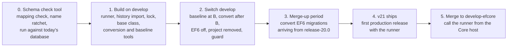
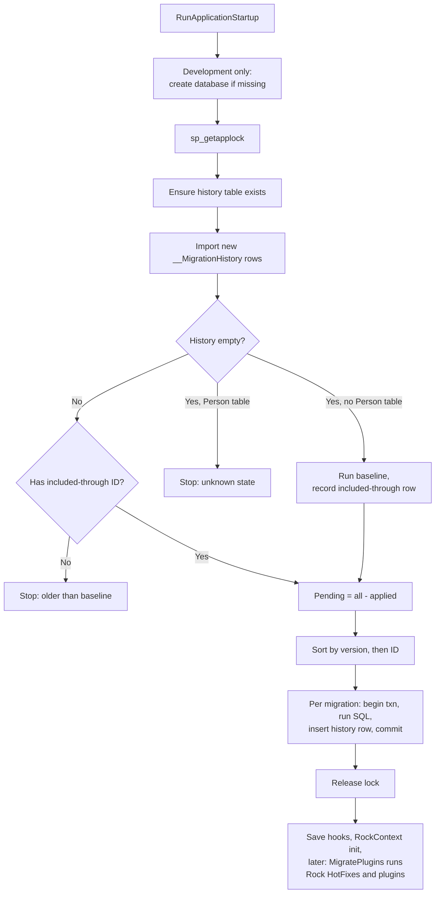
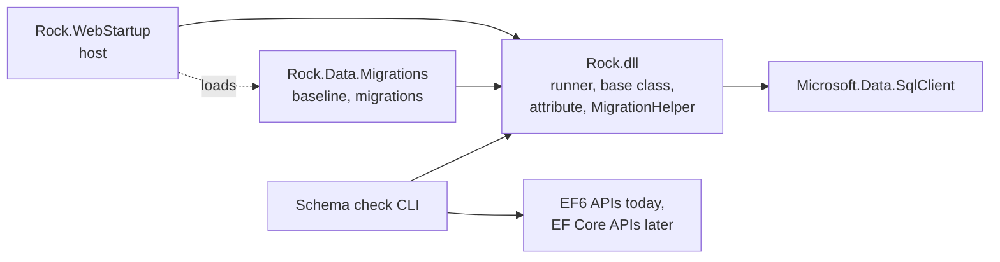

# SQL Migrations on .NET Framework

## Summary

The parent spec, *Cross-Platform SQL Migrations* (`specs/261023-cross-platform-sql-migrations.md` on the `develop-efcore` branch), replaces EF6 schema migrations with SQL migrations run by one set-based runner. This spec implements that design on `develop`, where Rock, `Rock.Migrations` and `Rock.WebStartup` target net472 and EF6 is the only model. The new code avoids direct EF6 and EF Core types (it opens its own `SqlConnection` from a connection string rather than taking a `DbContext`), so it ships to production on WebForms and builds unchanged for .NET Core after the regular develop merge into `develop-efcore`. Rock entities and services are fine to use, since each branch compiles them against its own EF. EF APIs are used directly only by the model adapter of the schema check tool, which verifies that the migrated database supports what the entity model maps. The transition replaces EF6 history up to a released version B with a baseline and converts every later EF6 migration, keeping its EF6 ID so existing databases see it as already applied; that lets develop turn EF6 off in one change while release-20.0 is still adding EF6 migrations. Requirements below restate the parent where they still apply, and add what a code review of the parent found.

## Motivation

- **develop is the production line.** The runner, the baseline and the switch have to ship in a real WebForms release before a .NET Core host can rely on them. Building on `develop-efcore` first would mean merging a production-critical startup change backward.
- **develop flows into develop-efcore.** Code written here reaches the EF Core branch on the next merge, so one implementation serves both.
- **Concurrent release tracks need concurrent schema changes now**, not after the .NET Core switch (parent spec, Motivation). While v20 is in alpha, release-20.0 holds the EF6 migration token and develop cannot add schema changes at all.
- **Rock's HotFixes exist only because of the token.** Once branches can add migrations independently, Rock's own fixes can use the same format.
- **The review of the parent spec found gaps** that apply on both branches: the existing plugin runner does not record a migration in its transaction, nothing stops two web farm nodes from migrating at once, the history table cannot exist before the baseline, and `Rock.Migrations` holds startup code and resources besides migrations.

## Requirements

### Platform and dependencies

- New code MUST build for whatever frameworks `Rock.dll` targets: net472 on develop, net472 and net10 on `develop-efcore`. It references `Rock.dll`, so on develop it cannot target .NET until Rock does; what carries it across is the rule below, not multi-targeting.
- New code SHOULD NOT declare properties, fields, parameters, return types or variables of types from `System.Data.Entity` or `Microsoft.EntityFrameworkCore`, where that can be avoided. For example, the runner takes a connection string and opens its own `SqlConnection`; it does not take a `DbContext`.
- Using Rock entities and services (`ServiceJob`, `ServiceJobService`, `RockContext` through `RockApp.Current.CreateRockContext()`) is allowed. Each branch compiles them against its own EF, so they are not direct EF dependencies.
- New code MUST NOT use `System.Web`.
- Database access in the runner and migrations is plain ADO.NET through `Microsoft.Data.SqlClient`, which Rock already references on develop (`Rock/Rock.csproj:51`, 6.1.4).
- The runner MUST build its connection string with `SqlConnectionStringBuilder` and set `TrustServerCertificate = true` unless the connection string asks for encryption (`Encrypt=True` or `Strict`), in which case it keeps the connection string's own `TrustServerCertificate` (`Rock.Data.SqlConnectionStringDefaults`). `Microsoft.Data.SqlClient` 4.0 and later encrypts and validates the server certificate by default, while Rock's EF6 workload uses `System.Data.SqlClient`, which encrypts only when asked. Without the default the runner would fail against servers EF6 connects to fine (local development SQL Server, on-premises servers with self-signed certificates). Changed 2026-11-25 after review: it first forced `true` always, as the distributed lock provider does (`Rock/Bus/Locking/SqlServerDistributedLockProvider.cs:433`), which overrode a site's explicit `Encrypt=True;TrustServerCertificate=False` (the usual Azure SQL connection string) for the connection that runs migrations.
- Placement, following existing patterns:

  | Code | Lives in | Existing pattern |
  |---|---|---|
  | Runner (discovery, ordering, history table, lock, database classification) | `Rock.dll` (`Rock/Data`), internal, beside the base class it drives; it throws its own `SqlMigrationException`, which the host turns into its startup error | `Rock.Data.MigrationHelper` |
  | Migration base class, attribute | `Rock.dll` | `Rock.Plugin.Migration`, `Rock.Data.MigrationHelper`, `Rock.Data.IMigration` |
  | Baseline, converted and new migrations | New `Rock.Data.Migrations` assembly referencing `Rock.dll` | `Rock.Migrations` |
  | `RockMigrationHelper` | Stays in `Rock.dll` (`Rock/Data/MigrationHelper.cs`), unchanged | |

- The runner MUST take what it needs from the host through an options POCO (connection string, current Rock version, assemblies to scan, logging callback, whether this is a development environment), so the same code serves the WebForms host, the Core host and the integration test database builder.
- The schema check tool's model adapter is the only code that uses EF APIs directly (EF6's mapping API today, EF Core's `IModel` on `develop-efcore`; see Schema checks).

### Runner

- MUST be a new method called from `RockApplicationStartupHelper.RunApplicationStartup` at the point where `MigrateDatabase` ran (on this branch, `RunSqlMigrations` at `Rock.WebStartup/RockApplicationStartupHelper.cs:158`), before save hooks and `RockContext` initialization. It MUST NOT be an edit inside `HasPendingEFMigrations` / `MigrateDatabase`, which are wrapped in `#if REVIEW_WEBFORMS` on `develop-efcore`, so the merge stays clean.
- MUST be set-based: apply every migration not recorded as applied, regardless of whether later migrations have run.
- MUST order pending migrations by target Rock version (compared as `System.Version`), then migration ID (numeric).
- MUST run each migration in its own transaction and write its history row with plain SQL on the **same** `SqlTransaction`, then commit. The existing plugin runner does not do this: it commits at `RockApplicationStartupHelper.cs:1098`, then records through a separate EF context at lines 1106-1107, so a crash in between reruns the migration. Fixing `RunPluginMigrations` is out of scope for this spec.
- MUST run every migration in a transaction, with no opt-out. A migration outside a transaction could leave a half-applied change and would have to be safe to rerun, and no migration needs one, so statements SQL Server does not allow in a transaction (full-text index changes, `ALTER DATABASE`) are not supported in migrations. Adding an opt-out needs an approved decision first (decided 2026-11-16; the POC's `IsTransactionDisabled` was removed).
- MUST NOT use `PluginMigrationService` or write `__MigrationHistory`. It reads `__MigrationHistory` only for the history import (see Transition), with plain SQL, not EF.
- MUST serialize across web farm nodes with a database-level application lock (`sp_getapplock`, session owner, one fixed resource name) held for the whole run. A node that waits for the lock MUST re-read the applied set after acquiring it. This is a database lock, not an in-process `lock()`.
- MUST wait up to 60 seconds for the lock. If it is not acquired, the runner MUST fail startup with a clear error rather than keep waiting. The supported web farm upgrade is to stop every node, upgrade one so it migrates the database, then copy the RockWeb folder to the others, so a long wait means something unexpected is holding the lock. On IIS the failed start triggers another start anyway; the point of failing is that the log says what is happening.
- While waiting and on timeout, the runner MUST log through the host's logging callback. On WebForms that is `MigrationLog.csv`, the file testers send in: `RunSqlMigrations` writes the system information first, then each runner message, SQL Server's informational messages as `WARNING:` lines, and the error that stopped startup as an `ERROR:` line. A start with nothing to run writes nothing there.
- On timeout it SHOULD log who holds the lock, best effort: the holding session's host name, program name, login time and session ID from `sys.dm_tran_locks` (resource type `APPLICATION`) joined to `sys.dm_exec_sessions`. That query needs `VIEW SERVER STATE` (`VIEW SERVER PERFORMANCE STATE` on SQL Server 2022 and later), which Rock's login may not have; without it, the runner logs that the holder could not be identified. The runner's connection SHOULD set `Application Name` to identify itself (for example `Rock Migrations`), so a holder seen from another node or in SSMS is recognizable.
- MUST create the history table after acquiring the lock, not before, so two nodes starting at once cannot race on `CREATE TABLE`.
- MUST create the database when it does not exist and the host reports a development environment, before calling `sp_getapplock` (which needs a connection to the database). This keeps what EF6 did: before the switch, `HasPendingEFMigrations` treated "Cannot open database" as pending migrations when `HostingEnvironment.IsDevelopmentEnvironment` was true, and EF6 `DbMigrator` then created the database. The runner connects to `master`, checks `DB_ID()`, and runs `CREATE DATABASE` only if it is missing. The development flag comes from the options POCO, since the runner cannot use `System.Web`. Outside development, a missing database MUST fail startup with a clear error.
- MUST fail startup with a clear error naming both classes if two discovered migrations share an ID, before running anything (as `RunPluginMigrations` does for duplicate numbers).
- MUST stop at the first failure, leave later migrations unapplied, and log the failure the way plugin migrations do today (`RockStartupException`, `LogError`).
- SHOULD support an optional minimum Rock version per migration, matching `MigrationNumberAttribute.MinimumRockVersion`. The target version is a sort key only and does not gate execution.

### History table

- MUST be a dedicated table named `[RockMigration]`, owned and created by the runner (`IF NOT EXISTS`) before it reads applied IDs. It cannot come from the baseline, because the runner has to read it before deciding whether to run the baseline.
- MUST NOT be an EF entity, so neither EF model depends on it. The mapping check ignores it as an unmapped table.
- MUST have these columns at least:

  | Column | Type | Purpose |
  |---|---|---|
  | `Id` | `int IDENTITY`, clustered primary key | Actual install order. Migrations may be applied out of ID order (a late v20 migration after a v21 one), so the ID alone does not say what ran first. |
  | `MigrationId` | `bigint`, unique index | The migration's `yyyyMMddHHmmss` ID. The unique index makes a duplicate run fail instead of double-recording. |
  | `TargetVersion` | `nvarchar`, nullable | Target Rock version declared by the migration. Null on imported rows that have no converted migration (everything the baseline replaced). |
  | `AppliedVersion` | `nvarchar`, nullable | Version of Rock that was running when the migration was applied (the current Rock version the host passes to the runner). Shows, for example, that a v20 migration was applied by a v21 build. Null on rows imported from `__MigrationHistory`. |
  | `MigrationName` | `nvarchar` | Class name, for readability. |
  | `AppliedDateTime` | `datetime` | When it was applied (when it was imported, for imported rows). |
  | `DurationMilliseconds` | `int`, nullable | How long it ran. Null on imported rows. |

- Install order is read with `ORDER BY [Id]`, never by `MigrationId` or `AppliedDateTime` (clock changes and web farm nodes make the date unreliable for ordering).
- The name is distinct from EF6's `[__MigrationHistory]` and from `[PluginMigration]`. It matches the EF6 base class `Rock.Migrations.RockMigration`, which is harmless because the table is not an EF entity and that class leaves the deployment at the switch.

### Migrations

- Each migration MUST be a C# class in the `Rock.Data.Migrations` assembly that only emits SQL, declaring a unique ID and a target Rock version through an attribute. SQL MAY live in embedded script files instead of C# strings (see SQL script files below).

### SQL script files

- Scripts are committed to git **uncompressed**, always, as `.sql`. Nothing is ever compressed by hand.
- The build compresses every `.sql` and embeds the compressed copy; the `.sql` itself is never embedded. Not through a `.resx`.
  - A new `GzipFiles` task in `Dev Tools/Rock.Build.Tasks` (beside `CopyToRockWeb`) compresses each script into `$(IntermediateOutputPath)sql\`. The prebuilt `libs/build-tasks/net472` and `net6.0` DLLs are rebuilt and committed, as for any change to that project, and `Directory.Build.props` already loads them for both Visual Studio and `dotnet build`.
  - The compress target is incremental (`Inputs` / `Outputs`, so only changed scripts are recompressed). A second target always adds the compressed files as `EmbeddedResource` items and to `FileWrites`, so they are embedded even when compression is skipped and removed by Clean.
  - The `LogicalName` MUST be the file name alone (`20261027143015-spCrm_UpdatePerson.sql.gz`), so manifest names do not depend on folder names (`Version 21.0` is mangled in default manifest names). Flattening into one folder is safe because every name starts with a unique migration ID.
  - Output goes only to `obj/`, which is already ignored, so no `.gitignore` rules or extra source folders are needed.
- A script's file name MUST start with its migration's ID:
  - `20261027143015.sql`: the migration's single, unnamed script.
  - `20261027143015-spCrm_UpdatePerson.sql`: a named script; the part after the first `-` is the suffix (`spCrm_UpdatePerson`). A migration that updates several stored procedures has one file per procedure, so each file can be replaced wholesale with the procedure as scripted from SSMS.
  - Suffixes are letters, digits and underscores only.
- The base class loads scripts by convention, so migration code never contains a resource name:
  - `SqlResource()` runs the unnamed script for the current migration.
  - `SqlResource( string suffix )` runs the named script.
  - Every embedded script is `.sql.gz`, so there is one code path: load the resource, decompress with `GZipStream` (as `AddMetaData` does today), run it. Each throws a clear error naming the migration and the expected file if the resource is missing.
  - `BulkResource( table )` loads `{id}-{table}.json` the same way and bulk copies its rows into the table (`Rock.Data.MigrationBulkLoader`, `SqlBulkCopy` with identity values kept and `CHECK` constraints checked). The file names its columns and holds one row per line; the loader rejects a file that does not cover every column the table takes a value for. A file may set `generateGuid`, leaving out `Guid` so every row gets a new one. JSON data files follow the same rules below as scripts.
- Committed `.sql.gz` files are not allowed. Git already stores objects zlib-compressed and delta-compresses between versions, so a plain `.sql` costs about what a `.gz` would in the repository, while staying reviewable and diffable. A committed `.gz` would be stored as an opaque binary with no useful deltas.
- No single `.sql` or `.json` file may reach GitHub's 50 MB warning size (GitHub rejects files over 100 MB). The baseline, which will be larger than the 2013 `CreateDatabase.sql` (55.8 MB), MUST be split into ordered named files (`{baselineId}-01_Schema.sql`, one `{baselineId}-{Table}.json` per table, `{baselineId}-03_Constraints.sql`), run in order by `SqlResource( suffix )` and `BulkResource( table )`.
- Size context (measured 2026-10-27): every script under 128 KB in `Rock.Migrations` and the HotFixes totals about 2.0 MB raw and compresses about 80%. `RockWeb/Bin/Rock.Migrations.dll` is 158.7 MB, almost all of it the 820 EF6 model snapshot `.resx` files (115.7 MB) and the uncompressed `CreateDatabase.sql` (55.8 MB, 9.4 MB compressed). The switch drops the snapshots, and build-time compression shrinks everything else, the baseline included.
- A unit test MUST fail the build when:
  - a `.sql` script on disk has no matching embedded resource (not included);
  - an embedded resource does not decompress to bytes identical to its `.sql` on disk (not compressed, or stale);
  - an embedded resource has no `.sql` on disk;
  - a script's ID prefix does not match a migration in the assembly (orphan script);
  - a suffix contains characters other than letters, digits and underscores;
  - a `.sql.gz` file is committed anywhere in the migrations project;
  - a `.sql` or `.json` file is 50 MB or larger.
- Precedent: existing EF6 migrations and HotFixes already name scripts after the migration with a descriptive suffix (`202604272241483_AnotherPersonMergeFix_spCrm_PersonMerge.sql`, `313_FixPersonDuplicateFinderNullSelfJoinPerformance6959_spCrm_PersonDuplicateFinder.sql`), but join them with `_`. The `-` separator is unambiguous because IDs are digits only and suffixes cannot contain `-`.
- IDs MUST be unique without coordination between branches: a `yyyyMMddHHmmss` timestamp stored as a number (`long` in C#, `bigint` in SQL), for example `[SqlMigration( 20261027143015, "21.0" )]`. Seconds matter because an AI agent can write several migrations in the same minute. A number sorts correctly with no dependence on string length, and leaves room (19 digits) for more precision later. EF6 IDs are strings with 15 digits plus the name, such as `201311251734059_CreateDatabase`; their first 14 digits are a valid ID in this format, which is what lets converted migrations keep their identity (see Transition).
- Seconds lower the collision risk but do not remove it, since an agent writing a batch often increments the timestamp rather than reading the clock. A unit test MUST check that every migration ID is exactly 14 digits, parses as a valid `yyyyMMddHHmmss` date, and is unique across the assembly, so a bad ID fails the build rather than startup.
- Migrations MUST be idempotent where practical (`IF NOT EXISTS` / `IF EXISTS`).
- Migrations in concurrently developed versions MUST be independent; the commute check enforces this.
- Down migrations are not required.
- **Undoing a migration during development.** Decided 2026-11-17: there is no `Down()` and no runner command to step back. The `/migration` skill MUST cover it in three parts:
  - **Back up first (always).** When it writes or converts a migration, the skill reminds the developer to back up the database, or take a SQL Server database snapshot (`CREATE DATABASE ... AS SNAPSHOT OF`), before running it. Restoring the backup or reverting to the snapshot (`RESTORE DATABASE ... FROM DATABASE_SNAPSHOT`, with Rock stopped) is the exact undo, data included. Snapshots are in every SQL Server edition since 2016 SP1, but not in Azure SQL Database.
  - **Forget the migration (on request).** The skill gives the SQL that deletes the migration's `[RockMigration]` row, so it runs again at the next start. Because migrations are idempotent where practical, this is enough to rerun a corrected additive migration; it does not undo what the first run did.
  - **Undo script (on request).** The skill tries to write SQL that reverses the migration and then deletes its `[RockMigration]` row, to run by hand in SSMS. It is a best effort that nothing tests, and a data migration often cannot be reversed because the original values are gone, so the skill says so and points back to the backup. The script is a scratch file, never committed: a `.sql` file in `Rock.Data.Migrations` with no migration fails `SqlMigrationFileTests` as an orphan.
- C# work against the database (loading entities, calling services) MUST NOT run inside a migration. It goes into a run-once post-update `ServiceJob`, Rock's existing pattern (about 115 EF6 migrations already create one). `IRockStartup` runs on WebForms, so this works on develop today. This includes any `RockContext`, direct or indirect (services, cache misses, attribute loading), and `DbService`: they open a second connection outside the migration's transaction, so they cannot see its changes, can block on its locks and are not rolled back with it.
- The runner MUST enforce that rule. While a migration is created (its constructor and field initializers) and while its `Up()` runs, `Rock.Data.MigrationExecutionScope` marks its execution flow (an `AsyncLocal`, so tasks the migration starts are covered and other threads are not), and every `Rock.Data.DbContext` constructor and every `DbService` connection throws, naming the migration. The check reads a static counter first, which is zero except during a migration, so outside migrations it costs one field read (measured 0.44 ns, against microseconds to build a `RockContext`). Tests also run migrations with every `RockApp` connection string unusable and the caches cleared (`TestMigrationRunner`), which catches any other route to `RockApp`'s database; it cannot replace the runtime check, because tests build from empty and miss code that runs only on upgrade.
- The migration base class is `Rock.Data.Migration` in `Rock.dll`, beside `IMigration` and `MigrationHelper`, so no new namespace is needed. It MUST be `internal`, so it can be renamed or reshaped later without a breaking change; the migration attribute SHOULD be `internal` for the same reason. `Rock.dll` grants `InternalsVisibleTo` to `Rock.Data.Migrations` and `Rock.WebStartup` (`Rock/Properties/AssemblyInfo.cs`), and to the schema check tool if it needs them. The grant to `Rock.Migrations` was removed with the EF6 project (2026-11-16). This keeps the new format for Rock's own migrations only; plugins keep using `Rock.Plugin.Migration`.
- Migration files SHOULD NOT import `Rock.Plugin`, where `Migration` would be ambiguous with `Rock.Plugin.Migration`.
- The migration base class MUST implement `Rock.Data.IMigration` and expose `RockMigrationHelper`, as `RockMigration` and `Rock.Plugin.Migration` do today. `Rock.Data.MigrationHelper` already builds SQL from strings, `SystemGuid` constants and `Rock.Enums` types with no EF types, so it stays where it is.

### Schema DDL

- Schema changes (tables, columns, keys, indexes) are written as raw SQL, typically by AI agents, with the schema checks as the gate. There are no DDL helper methods for now.
- Names MUST follow EF6 conventions, because every name in today's schema came from EF6 and later migrations drop and alter objects by name: `PK_dbo.Table`, `FK_dbo.Table_dbo.Target_Column`, `IX_Column` (multi-column and explicitly named indexes in today's schema keep their existing names). A wrong name passes at first and breaks a later drop-by-name statement, so the name ratchet enforces the pattern on every new name (see Schema checks).
- DDL MUST be guarded for idempotency (`IF NOT EXISTS` / `IF EXISTS` against `sys.*` views), per Rock's SQL conventions.
- The `/migration` skill MUST document the naming conventions and guards, pointing at the converted migrations as examples.
- Base class methods MUST NOT use EF6 `MigrationOperation` types (the `Rock.Plugin.Migration` schema helpers do, which is why they do not compile on net10).
- DDL helper methods MAY be added later if repeated patterns justify them.

### Moving out of the EF6 project

- At the switch, these move out of the EF6 `Rock.Migrations` project before it is removed:
  - `RockStartup/DataMigrationsStartup.cs` (the `IRockStartup` that runs post-update jobs) moves to `Rock.dll` as `Rock.Jobs.DataMigrationsStartup` (`Rock/Jobs/PostUpdateJobs`), next to the jobs it runs. It is not part of the migrations, so `Rock.Data.Migrations` holds only migrations. It stays `public` with `[RockInternal( "21.0", true )]` because the WebForms Rock Update block reads its run-once job lists; it becomes `internal` when that block is converted to Obsidian.
  - `Migrations/RockMigrationSQL.resx` content still referenced by later code, and the seed data under `Migrations/CreateDatabase` (`AddMetaData` name data) if the baseline needs it as a separate resource, move into the migrations assembly as plain `.sql` scripts. The existing `.gz` seed files are decompressed and converted, since committed `.gz` files are not allowed.
- The new assembly is `Rock.Data.Migrations`, with a matching root namespace. Reusing `Rock.Migrations` (parent spec) would conflict with the EF6 project while it exists, and would defeat the stray-file guard, since release-20.0 keeps adding files under `Rock.Migrations/` until v20 ships. The plural follows the .NET Framework Design Guidelines (plural namespace names where appropriate, and no namespace sharing a name with a type) and matches `System.Data.Entity.Migrations` and `Microsoft.EntityFrameworkCore.Migrations`.

### Transition: baseline at B, converted migrations after B

The transition rests on **ID continuity**: an EF6 migration converted to the new format keeps its EF6 ID, so an existing database that already ran it through EF6 sees it as applied. EF6 IDs are 15 digits (`yyyyMMddHHmmss` plus one); the first 14 are the new format, and truncating all 839 produces no duplicates (checked 2026-10-27). Conversion is therefore invisible to existing databases and does not have to happen all at once.

- **Baseline at a frozen version B.** New installs start from a baseline migration whose ordered named scripts (split to stay under GitHub's file size limits, see SQL script files) produce the schema and seed data of released version B. B MUST be a released version: released branches never receive EF6 migrations (they use HotFixes), so B cannot change underneath the baseline. B is 19.8 (decided 2026-11-16). The minimum version Rock upgrades from after the switch is 19.1, the first 19.x release (decided 2026-11-25; it was 19.8 until then), enforced by `RequiresVersion` (see History import and baseline check). Every 19.x release from 19.1 on has the same EF6 history through `BaselineIncludesThroughMigrationId` (release branches get no EF6 migrations), and every HotFix in 19.8.1 that an older 19.x release lacks is absorbed by a converted rollup after the baseline (`Rollup_20260708`, `Rollup_20260819`, `Rollup_20261014`, `Rollup_20261109`), so those sites run its code on upgrade. The 19.0 line had only pre-release builds, which lack the history and are stopped by the history check. Building each release package includes a final upgrade test from the minimum version. The baseline was regenerated on 2026-11-17 from the 19.8.1 release build (tag `19.8.1`): the first one was built from `hotfix-19.8` before HotFixes 336 and 338 landed, so it lacked their `PluginMigration` rows. Apart from those rows and the data the two HotFixes change, the difference is the order in which startup registered entity types, REST actions and views, which changes `Id` values and the `EntityTypeId` literals in the `AttributeValue_*` views.
- **The baseline has a fixed ID**, `20131125173405` (the first 14 digits of EF6's `201311251734059_CreateDatabase`, as the 2021 squash kept that ID), and every squash keeps it, so a database that recorded one baseline never runs another. The runner finds the baseline by that ID and handles it before every other migration; it is not sorted with them. Its target version is the Rock version B it builds (`19.8`), written to its history row and used in error messages, and never read back for any check. At a later squash it changes to B'; existing rows keep the version that was current when they were written.
- **Every EF6 migration after B is converted** to `Rock.Data.Migrations`, keeping its 14-digit ID and taking its target version from its version folder (`Version 20.0/Version 20.0/`). Sorting the converted migrations by version, then ID, gives exactly the EF6 ID order (checked for every migration on 2026-10-27), so nothing reorders. EF6 schema calls become the exact SQL EF6 would have run, emitted once by `SqlServerMigrationSqlGenerator`; migrations that read the database in C# (`SqlScalar`, `DbService`) are ported by hand. With B at v19, that is the 46 migrations in `Version 20.0` today, about 4 of them by hand.
- The converted migrations also serve as the reference set for authoring: real, production-proven migrations in the new format for people and AI agents to follow.
- **EF6 is turned off on develop in one change** (the switch), not after a period of running side by side. develop does not hold the EF6 migration token while v20 is in alpha, so it loses nothing; release-20.0 stays on EF6 until v20 ships. After the switch, develop never runs EF6 migrations. develop switches as soon as the remaining work is done (decided 2026-11-16), and v21 is the first release that uses the SQL migrations. Every in-flight branch with an EF6 migration converts it when it merges.
- At the switch, `HasPendingEFMigrations` and `MigrateDatabase` MUST stop running EF6 `DbMigrator`. `HasPendingEFMigrations` returns `true` when `__MigrationHistory` is missing, which on a baseline-built database would run every EF6 migration against it. Both are public, so they stay, marked obsolete, and return `false` (no migration pending, none run). Anything else that reads `__MigrationHistory` MUST read `[RockMigration]` instead. At the switch the only other reader was the System Information block, which shows the last core migration.
- At the switch, the EF6 `Rock.Migrations` project is removed from develop: migrations up to B are replaced by the baseline, later ones are converted, and `Rock.WebStartup` drops its references to `Rock.Migrations.RockMigration` and `RockMigrationsLogger`.
- The first release with the switch MUST delete `Bin/Rock.Migrations.dll` during update. A stale copy would still be scanned at startup, running `DataMigrationsStartup` twice (once from each assembly) and exposing its EF6 migration types.
  - The update package's `install/deletefile.lst` does this. Verified 2026-11-16: `RockInstaller.ProcessDeleteFiles` (`Rock.Update/RockInstaller.cs`) reads the list from the package after copying the content files, takes paths relative to the site root (a leading `RockWeb\` is stripped), and moves each file into the update backup rather than deleting it, so a failed install restores it. The list is split on `Environment.NewLine`, so it MUST use CRLF line endings.
  - The package is built by a packaging tool in another repository, which compares clean builds and lists in `deletefile.lst` every file that is missing from the new one. Confirmed 2026-11-17: `Rock.Migrations.dll`, its `.pdb` and its `.xml` drop out of the clean build once the project leaves `Rock.sln`, so the tool lists them with no manual step.
- Developer machines: `deletefile.lst` reaches only sites that update through Rock Update, and `RockWeb/Bin` is git-ignored, so developer machines keep the stale files. Decided 2026-11-17 that developers delete `RockWeb/Bin/Rock.Migrations.dll`, `.pdb` and `.xml` themselves; no build step or startup check removes them. A stale copy is mostly inert: the SQL migration runner only searches the assemblies it is given, and the plugin migration scan finds no `Rock.Plugin.Migration` types in it. Two effects remain while it is there. `Reflection.GetPluginAssemblies` loads and scans the 159 MB file on every start, and `RunStartups` runs its old `Rock.Migrations.RockStartup.DataMigrationsStartup` beside the new one, since the full names differ and the development environment check lets both through. On an existing developer database the old copy's run-once jobs have already run and deleted themselves, so it does nothing; on a fresh database it can run the same run-once jobs in parallel with the new copy. The switch announcement to developers MUST say to delete the files.
- `RockContextConfig` already sets the EF6 initializer to null (`Rock/Data/RockContextConfig.cs:37`), so EF6 does not need `__MigrationHistory` at runtime.
- `Rock.Tests.Integration` MUST build its database from baseline plus runner after the switch (`TestFramework/Database/LocalDatabaseManager.cs`, `DatabaseContainerImageBuilder.cs`).

#### History import and baseline check

- On each start, after acquiring the lock, the runner MUST copy any `__MigrationHistory` row whose truncated ID is not yet in `[RockMigration]`, in EF6 ID order, so `[Id]` order matches the order EF6 applied them. It is a plain SQL read; `__MigrationHistory` is left in place and never written. Repeating the check each start is cheap and makes the import idempotent. Only rows whose `ContextKey` is Rock's (`Rock.Migrations.Configuration`) are copied, so a plugin's own EF6 code-first history is never recorded as Rock's; every Rock database checked has all its rows under that key. The database filters out rows already recorded, so a normal start reads nothing and opens no transaction (both added 2026-11-17 after review). The import keeps running on every start because a developer can switch to a release branch, where EF6 adds rows, and back.
- Imported rows take `MigrationName` from the EF6 ID's name part, `TargetVersion` from the matching converted migration when there is one, and leave `AppliedVersion` and `DurationMilliseconds` null, which marks them as imported.
- `201311251734059_CreateDatabase` imports like any other row. Its truncated ID is the baseline's fixed ID, so an EF6 database has the baseline recorded by the import, and the baseline never runs against it.
- `Rock.Data.Migration.BaselineIncludesThroughMigrationId` holds the ID of the last migration the current baseline replaces. It changes at every squash, with the baseline's target version; the baseline `package` step prints the exact lines to paste.
- On every start, after the import and before anything runs, the runner MUST check the history:

  | History (after import) | Action |
  |---|---|
  | Empty, no `Person` table | New install: run the baseline. In the same transaction, also record a row for `BaselineIncludesThroughMigrationId`, so a database built from the baseline looks like one that ran those migrations. |
  | Empty, `Person` table exists | Stop: Rock tables with no history, so the state is unknown. |
  | Not empty, missing `BaselineIncludesThroughMigrationId` | Stop: the database is older than the baseline, so a squash was skipped. |
  | Not empty, has it | Continue. If the baseline row is somehow missing, record it; the baseline never runs against a database that has history. |

- The check reads `[RockMigration]` after the import, so one rule covers the EF6 cutover (the ID arrives through the import) and every later squash (a database that went through the squashed version recorded the ID itself, or through the baseline's extra row).
- A database that fails the check is already broken: its files are newer than its schema, and Rock upgrades only from inside Rock, so it cannot upgrade itself out. The check exists to stop before migrations damage it further. The error MUST say so plainly, that Rock cannot run against this database and the fix is to restore the database and files from before the new version was installed, and MUST NOT suggest upgrading to B first.
- A migration with a lower target version than the baseline (a 19.x fix absorbed after a v20 squash) still runs after the baseline on a new install, against the newer schema. Absorbed HotFix code must already be safe to rerun, so it must also be safe there.
- If there are migrations but none has the baseline's ID, startup stops before anything runs.
- The update server's `RequiresVersion` remains the first gate: the release package for each switch or squash MUST require the minimum upgrade version: the oldest release whose history includes `BaselineIncludesThroughMigrationId` and whose missing HotFixes (those in B but not in that release) all run in migrations after the baseline. For the switch that is 19.1 (see Baseline at a frozen version B); at a later squash it is normally B', because the squash deletes the rollups that carried older HotFixes. Before the switch it was the only gate. Startup never checked that a database ran the squashed migrations: `HasPendingEFMigrations` compared only the newest migration ID in the assembly with the newest in `__MigrationHistory`, and EF6 ignores history rows whose migrations were deleted. (On this branch `HasPendingEFMigrations` is obsolete and returns `false`.) A database older than the boundary that bypasses `RockUpdate` (`RockWeb/Blocks/Core/RockUpdate.ascx.cs:281`), for example through files copied over a site by hand or a developer switching branches, has the remaining migrations run against the wrong schema and fails partway. The history check above is the backstop that stops it before anything runs.

#### Merge-up rule and stray-file guard

- After the switch, any EF6 migration that reaches develop by merge (from release-20.0, a hotfix branch, or a feature branch started before the switch) MUST be converted in the merge: same 14-digit ID, target version from its folder, and its snapshot `.resx` and designer files dropped. A v20 alpha database that already ran it through EF6 sees it as applied through the import; any other database runs the converted version.
- The conversion MUST be repeatable (a skill or a Dev Tools tool), because it is used three ways: the initial conversion at the switch, merge-ups from release-20.0, and feature branches that started with an EF6 migration.
- A test MUST fail the build when a merge brings back a migration that develop no longer builds or runs. Without it, a merge that adds a file under a removed folder produces no conflict: git adds the file, nothing compiles or runs it, and the migration is silently lost. A merge that changes a file develop removed is a modify/delete conflict, which already stops the merge.
  - Done 2026-11-17: the `Rock.Migrations` folder and `Rock/Plugin/HotFixes` were removed from develop, and `StrayMigrationFilesTests` in `Rock.Tests` (no database, so CI runs it on every pull request) fails when either folder has a `.cs`, `.sql`, `.resx` or `.csproj` file outside `bin` and `obj`, or when `Rock.dll` or `Rock.Data.Migrations.dll` has any `Rock.Plugin.Migration` type. It also fails when a `.cs` file under `Rock.Data.Migrations/Migrations` (outside `Baseline`) is not named `{14-digit ID}_{Name}.cs`, or a `.resx` file is there. The failure says to convert each file to `Rock.Data.Migrations` and delete it.
  - Git's directory rename detection sees the converted migrations as renames of the removed EF6 and HotFix files, so a merge that adds a new EF6 migration or HotFix reports a "file location" conflict and moves the file into `Rock.Data.Migrations/Migrations/Version 20.0/` (seen 2026-11-17 with HotFixes 346 and 347, and in a simulated merge of an EF6 migration). Accepting that location must still fail: EF6 IDs have 15 digits and HotFix files start with their number, so the file name check catches both, along with `.Designer.cs` and `.resx` files. A moved HotFix would also compile into `Rock.Data.Migrations.dll` and run through the plugin runner, which scans every assembly in Bin, so the type check covers that assembly too.
  - The file check reads the disk, not git, and skips `bin`, `obj` and other file types, because those stay behind as git-ignored files on developer machines.
  - The spec first called for failing on any type that derives from EF6 `DbMigration`. That was dropped: `Rock.Plugin.Migration` itself uses a private `DbMigration` subclass to generate SQL for its helpers, and an EF6 migration placed in a project that compiles already fails the build, since `Rock.Migrations.RockMigration` no longer exists.
  - An archive folder was considered instead of deleting: git follows a renamed folder, so a release branch's edit to a moved file would merge cleanly into code that never runs. Git history keeps the removed files.
- The switch MUST be proven, not reviewed line by line: build one database with today's EF6 migrations and one with baseline plus converted migrations, compare catalogs with the schema check tool's equivalence command, and compare table data, excluding columns that are not deterministic (generated GUIDs, timestamps). The data check excludes every GUID and date/time column by type, not through the allow list (decided 2026-11-18 after a review). A measurement that day found 65 of 300 GUID columns differing between an EF6-built and a baseline-built test database, including `Attribute`, `Auth`, `EntityType`, `Block`, `BlockType` and `DefinedValue`. Those columns are only partly random, since migrations write both fixed GUIDs and `NEWID()` into them, and `Id` values move between builds, so allow-listing them by column would skip exactly the tables a GUID comparison should cover. The data check therefore cannot catch a wrong GUID in a converted migration. That risk is accepted because conversions are straight copies, never retyped.

#### Baseline tool and periodic squash

- Baseline generation MUST be a repeatable, documented workflow backed by a CLI tool in `Dev Tools`, not a one-off. The database is built by a real Rock startup of **B's own release build**, not develop's code: B's migrations, HotFixes and job classes are what the baseline must capture, and later squashes use the new runner the same way. The CLI therefore prepares, checks and packages the database around that startup rather than being compiled against one Rock version. The workflow:

  1. **`verify`.** The CLI checks that the target database is empty, that the site's configuration is neutral (no developer settings, `RunJobsInIISContext` off so recurring jobs do not run), that the site build's version is B, and that the server is at least the minimum SQL Server version B supports (SQL Server 2022 for v19). The build server does not have to be the minimum version: the baseline test below proves the scripts on every supported version.
  2. **Real startup.** Start B's site against the empty database and let it settle: migrations, plugin migrations and HotFixes, entity, field and block type registration (including the background block type thread, `StartBlockTypeCompilationThread` in `Rock.WebStartup/RockApplicationStartupHelper.cs:1432`), `IRockStartup` startups, and the post-update jobs they run. Run any remaining run-once jobs from Rock (see Run-once jobs below). Then shut it down. The CLI's read-only `monitor` command reports when startup has settled: nothing outstanding by `cleanup`'s settle checks, and the registration tables (`EntityType`, `FieldType`, `BlockType`, `Block`, `Attribute`, `AttributeQualifier`, `AttributeValue`) unchanged by row count, highest `Id` and latest `ModifiedDateTime` for a quiet period (default 60 seconds). The quiet period stands in for the block type thread, which writes nothing that marks it finished; once the CLI runs the startup flow itself (see Startup options below), it knows when startup finishes and the quiet period goes.
  3. **`cleanup`.** The CLI does the following, in order, and reports what it did:
     - **Settle checks.** It fails, listing what is outstanding, unless every job on both `DataMigrationsStartup` lists is gone (the startup list and the 2 AM `scheduledRunOnceJobGuids` list), `PostInstallDataMigrations` has run and deleted itself, and every HotFix in B's `Rock.dll` is recorded in `PluginMigration`.
     - **Exception check.** If the exception log has rows, it lists them and stops. Startup exceptions can mean a broken snapshot. One-time exceptions from block conversion jobs (WebForms to Obsidian) are expected, so after reviewing them the person reruns `cleanup` with an explicit option that accepts them.
     - **Identity values.** It records `IDENT_CURRENT` for every table with an identity column. Rows deleted during startup (post-update jobs delete their own `ServiceJob` rows) leave a table's identity ahead of its highest `Id`, and a scripted insert would reset it to the highest `Id`. `package` reseeds each table to the recorded value so later migrations assign the same IDs as on an EF6-built database, which the equivalence check depends on.
     - **Reset state startup wrote.** `RockInstanceId`'s `CreatedDateTime` back to null (`IsNewInstallation()`, `Rock.WebStartup/RockApplicationStartupHelper.cs:646`, treats a value as an existing installation, and startup sets it around the migration run, `:137-145` and after it). The run-state columns of every `ServiceJob` row back to null (`LastRunDateTime`, `LastSuccessfulRunDateTime`, `LastRunDurationSeconds`, `LastStatus`, `LastStatusMessage`, `LastRunSchedulerName`).
     - **Delete per-site settings.** It deletes system settings Rock creates at runtime that hold the build site's values: `OpenIdConnectRsaKeys` (the OIDC signing key, encrypted with the build site's `DataEncryptionKey`) and `core_RockSecuritySettings` (which holds the security roles' members, including the Admin person's `Guid`). Rock creates both again when first needed.
     - **Undo the post-install job.** It deletes the job's output (`AnalyticsSourceDate`, `AnalyticsSourcePostalCode`, `IdentityVerificationCode`) and inserts the `PostInstallDataMigrations` job row again with the values the migration that created it used, so every new install runs it (see Run-once jobs below).
     - **Prune run data.** It empties exception logs, `History`, `ScheduleDate` (each schedule's dates two years either side of when it was written, which would anchor new installs to the build date; the nightly `RockCleanup` job fills it), `Interaction`, `InteractionSession`, `InteractionComponent`, `InteractionDeviceType`, `AttendanceOccurrence`, `ServiceJobHistory`, web farm nodes, and users marked online.
     - Every table step MUST skip a table that does not exist, so the list can name tables that newer versions add (for example a future `PersonSession` table) and still run against an older B.
  4. **`export`.** The CLI scripts the schema itself with SMO (`Microsoft.SqlServer.SqlManagementObjects`, a dependency of the CLI only), the library behind SSMS's Generate Scripts. Its options match the SSMS settings the 2022 guide uses: triggers included (SSMS's default leaves them out), no `USE` statements, no `CREATE DATABASE` (it scripts the objects inside the database), no filegroup clauses (`NoFileGroup`), and the minimum supported SQL Server as the target version. It writes the data as one JSON data file per table, one row per line in primary key order, which the baseline bulk loads: on the first v19 baseline that loaded in about 21s against about 25s for SMO's single-row `INSERT`s, and the data takes 3s to export instead of about 21s. Multi-row `INSERT`s were tried and loaded more slowly. One file per table keeps growth in one table from moving another's rows between files, and one row per line keeps a changed row a one-line diff. The order is schema without foreign keys, then data, then foreign keys and triggers; every file is UTF-8 and under 50 MB. SSMS Generate Scripts with the same settings remains the fallback; on the first squash it took about 30s against SMO's 43s for schema and data.
  5. **`package`.** The CLI does the remaining mechanical parts: gives the `Rock Instance Id` attribute's hard-coded `Guid` a `NEWID()` with an `UPDATE` at the start of the reseed script (a data file cannot hold `NEWID()`), adds the identity reseeds, generates the baseline migration class (fixed ID, target version B), and prints the exact `Rock.Data.Migration.BaselineIncludesThroughMigrationId` line to paste (the highest migration ID in `__MigrationHistory` / `[RockMigration]`, truncated to 14 digits). When the SSMS fallback was used, it also strips the `USE`, `CREATE DATABASE` and `ALTER DATABASE` header and footer, removes `TEXTIMAGE_ON [PRIMARY]` and `ON [PRIMARY]` from DDL lines only (never from inserted data), converts UTF-16 to UTF-8, and splits the file.

- An integration test MUST run the baseline and every migration on each SQL Server version B supports (Docker images, 2022 and 2025 for v19, plus Microsoft's Azure SQL Database container image, kept as a list so adding or dropping a version is one line) and fail if any migration throws. It does not compare the result with the source database. This replaces building on the minimum version: that rule held only at build time and on one server, while the test runs every time and catches newer types, newer built-in functions in views, functions, procedures and triggers (SQL Server checks those when the module is created), and anything SMO cannot express for the target that fails when it runs. It does not catch options a version ignores without an error, dynamic SQL inside modules (checked only when it runs) or data computed differently under a newer compatibility level. The Azure SQL Database container (added 2026-11-25) covers Azure's types, functions and options, but not the round-trip cost of a real Azure server (see the spatial index note below).
- Two runs of the workflow MUST produce the same baseline apart from values that differ on every build (dates and GUIDs from `GETDATE()` and `NEWID()` in migrations), with stable object and row order. Any other difference between two runs is state leaking from the run, so the comparison doubles as a check on cleanup.
- **Per-install values.** Some values MUST differ on every install, and the baseline's data files freeze them at the values of the database it was built from. With the runner a database can be built by starting Rock against an empty database (development, Docker, or a host that installs that way), not only by the installer's `Installers/RockInstaller/Data/sql-config.sql`, so the baseline itself MUST regenerate them:
  - The baseline class is `partial`. `package` generates `Baseline.cs`; `Baseline.Reseed.cs` is written by hand, kept across squashes, and holds one step per value, run after the data loads in the baseline's transaction. Today: the `RockInstanceId` setting's `Guid` (the instance ID, which the 2022 guide replaced by hand), and the built-in Admin person's and its primary alias's `Guid` values with every copy of them (made unique per install by `Rollup_20251022`).
  - Each step finds its rows by an `Id` or `Key` a squash cannot change, never by the frozen value, so it needs no edit at later squashes. Each step checks its row counts and that no copy of the old value is left, and throws naming the step when they are wrong, so a later migration that changes or deletes the row fails every new install, test runs included, instead of leaving the value frozen. An integration test loads the baseline twice and checks that the values differ and no copy of a frozen value is left.
  - A migration that creates a value that must differ per install cannot target it in a step yet (its `Id` is not known until a squash freezes it), so it is listed in `Rock.Data.Migrations/README.md` in the same change. Each squash turns the listed entries into steps (or `cleanup` deletions, for values Rock creates again at runtime) and clears the list. The `/migration` skill MUST tell authors to add the entry.
- The 2022 guide stripped `PAD_INDEX`, `SORT_IN_TEMPDB`, `ALLOW_ROW_LOCKS` and `ALLOW_PAGE_LOCKS` from `CREATE SPATIAL INDEX` statements for Azure SQL. Microsoft's current `CREATE SPATIAL INDEX` reference lists all four as applying to Azure SQL Database, so they are kept unless running the unstripped baseline against Azure SQL Database fails. Verified 2026-10-30: a fresh install on an empty Azure SQL Database (S3, from an on-premise development machine) ran the unstripped baseline and every migration with no errors or warnings. It was slow, though: the baseline took 460s against 24s locally, almost all of it round trips. The baseline sends about 7,100 batches (4,345 schema, 2,756 constraints) plus about 600 bulk-load round trips, at roughly 55 ms each. Merging batches at export, so that only views, procedures, functions and triggers get their own, would bring that to about 450; this is not done yet and is worth doing at a squash if Azure installs from an empty database matter. Since 2026-11-25 the SQL Server version test also runs the baseline and every migration on Microsoft's Azure SQL Database container (`mcr.microsoft.com/mssql/azure-sql-db-server`), so compatibility is checked on every run; only the round-trip cost still needs a real Azure server.

##### Run-once jobs: post-update versus post-install

- **Post-update jobs** MUST run before the snapshot. `DataMigrationsStartup` has two lists: jobs started at startup (`startupRunOnceJobGuids`) and jobs scheduled for 2 AM (`scheduledRunOnceJobGuids`), which do not run during a short startup and are run from Rock by hand. On an empty database they are quick and delete themselves. Left pending, the baseline would carry `ServiceJob` rows for job classes that a later release may delete.
- **The post-install job MUST be pending in the baseline.** `PostInstallDataMigrations` generates data relative to the install date (`AnalyticsSourceDate`) and data too large to ship in the installer (about a million `IdentityVerificationCode` rows). Its GUID is on the startup list, so B's startup runs it and it deletes itself; `cleanup` deletes its output and inserts the job row again. Run before the snapshot and kept, every new install would carry date data anchored to the day the baseline was built.
- Evidence: the 2021 script contains 37 `ServiceJob` rows, and the only run-once job among them is `PostInstallDataMigrations`, active, never run (`LastRunDateTime` NULL), on its daily schedule. Before the squash, `Rock/SystemGuid/ServiceJob.cs` defined 17 post-update jobs (`DATA_MIGRATIONS_74` through `DATA_MIGRATIONS_110_*` and the `MIGRATE_*` jobs) and `DataMigrationsStartup` listed 19 job GUIDs; none of them are in the script. The 2022 squash guide ("Create Rock DB Script for Installer or Migration Squish") shows how: it deletes `AnalyticsSourceDate` and `IdentityVerificationCode` and re-inserts the `PostInstallDataMigrations` row after startup.

##### Startup options for snapshot builds

- **Deferred** (2026-11-16) until it is next needed: most likely when the Rock site has a CLI runner (the EF Core branch's host), and v22 at the earliest. Until then the baseline workflow keeps using configuration, `monitor` and `cleanup`, which built the v19 baseline. The design below is kept for when it is picked up.
- Rock's startup SHOULD accept an options POCO (Rock's convention for behavior switches) with a snapshot-build setting, rather than being split into several method variants. In snapshot mode it runs what the baseline must capture and skips what writes run-specific state:

  | Runs | Skipped |
  |---|---|
  | Core migrations, plugin migrations and HotFixes | Job scheduler (beyond the post-update jobs) |
  | Entity, field and block type registration | Message bus and web farm startup |
  | `IRockStartup` startups and the post-update jobs | Version update notifications (`SendVersionUpdateNotifications`) |
  | | Theme updates, IP geo database download |
  | | `MarkOnlineUsersOffline`, cache warmup |

- Exceptions are not suppressed: `cleanup` lists them and stops until they are reviewed, then prunes them.
- Startup now lives in `Rock.WebStartup`: `RockApplicationStartupHelper.RunApplicationStartup` (migrations) and `RunApplicationStartupStage2` (registration, startups, scheduler, message bus, web farm and the rest), with `Global.asax.cs` only calling them and `RunApplicationShutdown`. Every step in the table above is there, so the options POCO lives in `Rock.WebStartup` beside them. (Decided 2026-11-16, after develop moved stage 2 out of `Global.asax.cs`.)
- Step 2 of the workflow MUST run the full RockWeb site for as long as WebForms blocks exist, even after the move. WebForms block registration compiles each `.ascx` through ASP.NET to discover the block's attributes, which needs a hosted site. Once WebForms blocks are gone, step 2 can become the CLI starting Rock itself through the options POCO. Until then, skipped steps are handled by configuration and `cleanup`.
- Precedent: the 2022 squash guide ("Create Rock DB Script for Installer or Migration Squish") documents the manual process this workflow automates: build on the minimum SQL Server version, settle, clean up, SSMS Generate Scripts, then hand edits. The 2021 squash (`f545a41a63`) did the same steps by hand. It built a database at about v11.3, scripted schema and data with SSMS Generate Scripts (UTF-16) into `201311251734059_CreateDatabase.sql` (38.7 MB to 55.8 MB), kept the `CreateDatabase` migration ID so existing databases skip it, deleted 1,012 files of pre-v12 migrations and 94 `RockMigrationSQL.resx` entries, and edited the code that still referenced them (`AddMetaData`, one v12 migration). An earlier squash (`bb53afc5be`, 2018) collapsed everything before v8 the same way.
- The baseline content MUST meet these conditions, each of which the 2021 script met or shows the need for:
  - **Built from B's released code on a clean database**, with no sample data, not from develop. The scripted state must equal the boundary exactly, so the first migration after B applies cleanly on top of it. In 2021 the v12 migrations were dated from July 2020, earlier than the October script, which was safe only because the script came from v11 release code.
  - **Includes `PluginMigration` rows** for the HotFixes the baseline contains, so a new install does not run them again. The 2021 script carries 143, up to HotFix 136.
  - **Excludes the migration history tables** (`__MigrationHistory`, `[RockMigration]`). The runner records the baseline itself, as EF6 wrote its own history rows after `CreateDatabase`.
  - **UTF-8**, not the UTF-16 that SSMS writes, so scripts diff and grep normally. The SMO export writes UTF-8 directly.
  - **Valid on the minimum SQL Server version B supports** (SQL Server 2022 for v19): the export targets that version and the baseline test runs the scripts on it and every newer supported version. The 2022 guide built on the minimum version instead.
  - **Includes the `Meta*` lookup data** (`MetaFirstNameGenderLookup`, `MetaLastNameLookup`, `MetaNickNameLookup`). The 2022 guide deleted it because the 2017 `AddMetaData` EF6 migration reloaded it on every new install, but the baseline replaces `AddMetaData`. No migration since v12 writes these tables, so the data is static and the next squash should script it identically, which git stores once. Their data files leave out the `Guid` column and set `generateGuid`, so the load gives every row a new one and each install has its own values, as `AddMetaData` did with `NEWID()` and `Guid.NewGuid()`. As `INSERT` statements they were 45 MB of the first v19 baseline and most of its load time; as JSON they are 9.1 MB raw (1.3 MB gzipped). The alternative, if they cost too much repository size, is to bulk load `AddMetaData`'s existing source files (1.4 MB, one of them already gzipped).
- **New-install-only changes** MAY be added to the baseline migration after it is generated, as `CreateDatabase.Up()` runs `NewInstallationGivingBlockReplacementAsOf17_3` today. They affect only new installs, since existing databases record the baseline without running it. The next squash folds them into the scripts and removes them.
- Because every script name starts with its own migration's ID, a remaining migration cannot load a deleted migration's script through `SqlResource()`, so a squash never needs the kind of edit the 2021 squash made to a v12 migration that used a deleted resource.
- The first switch is the first run of the tool. A later squash is another run at a later version B', plus deleting the migrations it replaces, pasting the new `BaselineIncludesThroughMigrationId`, and raising the minimum upgrade version through `RequiresVersion`, normally to B' (see History import and baseline check). The new baseline keeps the fixed ID and declares target version B'.
- Squashing is optional. EF6 cost about 200 ms per migration at startup, which is why Rock squashed before (`f545a41a63`, "Squish migrations older than v12.0", 2021-03-04). A SQL migration costs one transaction plus its own SQL, so the remaining reasons to squash are new install time and repository size.

### HotFixes

The new format replaces Rock's own HotFixes: they exist only so a branch without the EF6 token can ship non-schema changes, and the new format has no token. They retire gradually rather than at the switch.

**Today's practice: absorb and disable.** A HotFix does not stay live for long. At each release, its code is copied into a rollup EF migration, ordered by the version each HotFix targets (for example `Rollup_20261014` runs the v17.8 fixes 324 to 328, then the v19.5 fixes, then v20.0), and Rock.CodeGeneration's "Disable HotFix Migrations" option (`Rock.CodeGeneration/Pages/ModelGenerationPage.xaml.cs:2040`) renames the HotFix's `Up()` to `OldUp()` and inserts an empty `Up()`. As of 2026-10-27, 310 of the 323 HotFix files (numbers 1 to 336) are disabled; 13 are live (319 to 323 and 329 to 336). Two consequences carry over:

- Under EF6, absorbed code runs again on databases that already ran the HotFix, so HotFix code must be safe to rerun. In practice it is not always: HotFix 320's route swap moves Next-Gen check-in's routes to `checkin-classic` when it runs a second time (found by the POC's develop upgrade test). The new format runs an absorbed HotFix once per database through `ReplacesHotFixNumber` (see below), but rerun safety is still needed in two places: a migration with a lower target version than the baseline runs against the newer schema on a new install (see History import and baseline check), and a HotFix converted on its own can be absorbed again by a release branch's EF6 rollup that is later merged up and converted (see HotFix code MUST be safe to run twice, below).
- A disabled HotFix is still recorded: `RunPluginMigrations` runs its empty `Up()` and writes a `PluginMigration` row, so every install gets a row for every HotFix. On develop this ended when `Rock/Plugin/HotFixes` was removed (2026-11-17, see below).

**After the switch:**

- New Rock fixes on develop, and on any branch that has the runner, MUST be written in `Rock.Data.Migrations`, not `Rock/Plugin/HotFixes`.
- Branches without the runner (release-20.0, hotfix-20.x and older hotfix branches) keep writing HotFixes. When one is merged up, it MUST be absorbed into the new format and its file deleted (develop has no `Rock/Plugin/HotFixes` folder; the stray-file guard fails until this is done). Each HotFix becomes its own migration (no rollup): ID from the UTC time of the HotFix file's first commit (`TZ=UTC git log --diff-filter=A --format=%ad --date=format-local:%Y%m%d%H%M%S | tail -1`, without `--follow`, which picks up the wrong date; HotFixes 319 to 323, 329, 334 and 343 were converted before this used UTC and keep their author-local IDs, since the ID only orders migrations within a target version), target version from its `MigrationNumber` version. Version-then-ID ordering then does what the hand-ordered rollups do today: on a new install, the fix runs at the point in history its version implies.
- Each absorbed migration names the HotFix it replaces with `ReplacesHotFixNumber` on its `SqlMigration` attribute. After the baseline check, the runner records the migration as applied, without running it, on any database whose `PluginMigration` has that number for the `Rock` assembly. Absorbed code therefore runs exactly once on every database: as the HotFix where that already ran, and as the new migration everywhere else. The import comes after the baseline check, so a database the check refuses gets no history from it.
- The HotFixes live at the switch are absorbed the same way as part of the switch. As of 2026-11-16 that is 11 standalone conversions (339, 340, 343 and 345 at 17.8; 319, 323 and 334 at 20.1; 320, 321, 322 and 329 at 21.0). The others live on 2026-10-27 were absorbed by develop's own EF6 rollups first, so they arrive inside the converted `Rollup_20261109` instead.
- Decided 2026-11-17: the HotFix files are removed from develop now rather than at a later squash. Every HotFix was disabled by then, so they only wrote `PluginMigration` rows. Those rows matter only where the HotFix really ran, and those databases already have them; a fresh develop install runs the converted migration instead. Removing the folder also makes a merged-up HotFix fail the stray-file guard, and a release branch's edit to an existing HotFix a modify/delete conflict, instead of merging silently into a disabled copy. Before the removal, every HotFix not recorded in the baseline was checked to be converted on its own or absorbed into a converted rollup, and none had changed since. Databases rely on `RequiresVersion` to have run the older HotFixes first; the history check does not look at HotFixes. The one run-once job that read a script from `HotFixMigrationResource` (`PostV136FixIncorrectERAStartDate`) now holds the script itself.
- **The converted target version is the HotFix's `MigrationNumber` version, as written.** Decided 2026-11-17: the conversion trusts the source and never picks its own version, even when the source looks wrong. That version is meant to be the Rock version the HotFix was introduced in, and it now decides where the migration runs (target version, then ID), so a wrong value is a source error: it is fixed in the HotFix on the branch that owns it and reaches develop on the next merge-up, not corrected in the conversion. As with rerun safety, the conversion warns but accepts. It finds the version the HotFix was introduced in from git: the lowest-versioned `hotfix-X.Y` or `release-X.Y` branch whose history adds that HotFix file (fixes are usually written on the oldest branch and merged up; looking for the file rather than the commit also covers a cherry-pick). It accepts the written version without a warning when the major version matches and the minor version is within 1 of it, because a HotFix is often written before the branch's version number is bumped (on `hotfix-19.9`, Rock.dll may still say 19.8, so the HotFix must say 19.8 to run in testing). Otherwise it reports the HotFix number, the written version and the introduced version, and converts with the written version anyway. For example, HotFix 346 is written as 17.8 but first ships on `hotfix-17.13`, and HotFix 347 is written as 19.0 but first ships on `hotfix-19.9`, so their conversions target 17.8 and 19.0 and both are reported.
- **HotFix code MUST be safe to run twice.** EF6 already required this, since a rollup reruns absorbed code on every database that ran the HotFix, but it was never written down. It still matters after the switch: a release branch can absorb into an EF6 rollup a HotFix that develop already converted on its own, and that rollup is converted on merge-up and runs the code again on new installs and develop databases. Decided 2026-11-16: such rollups are converted as they are, not stripped of the already-converted HotFix code. Stripping would run the code exactly once, but it makes every merge-up a manual edit that no check verifies, and it silently drops any correction the release branch made in the rollup's copy. Converting as is keeps EF6's behavior, so it adds no new risk, and relies on this rule.
- `RunPluginMigrations` and `Rock.Plugin.Migration` stay for third-party plugins.

### Authoring

- After the switch, all schema and data migrations on develop MUST be written in the new format (by hand or by AI). EF6 cannot generate migrations there, since the EF6 project is gone; schema changes are raw SQL (see Schema DDL), and the converted migrations are the examples to follow.
- An entity change and its migration MUST land in the same change.
- **No file system.** A migration MUST NOT read, write, move or delete files (`System.IO`, `HostingEnvironment`, `MapPath`). Decided 2026-11-16:
  - A migration runs in a transaction, and a file change cannot roll back with it, so a later failure leaves files changed for a database that was not.
  - A migration runs on one node of a web farm, while files exist on every node.
  - Files an upgrade removes, such as a plugin's DLLs when the plugin moves into core, go in the update package's `deletefile.lst` (see Moving out of the EF6 project). One-time file cleanup that must also cover installs that skip Rock Update belongs in startup code, which runs on every node.
  - EF6 migrations did this rarely, and only as a fallback for `deletefile.lst`: Helix (2025) and the legacy Azure storage provider (`Rollup_20260708`, dropped in its conversion).
  - The `MigrationExecutionScope` guard cannot catch file calls. A CI check over `Rock.Data.Migrations` SHOULD fail on `System.IO`, `HostingEnvironment` and `MapPath`, with the other checks.
  - **Deferred design.** If a case comes up that `deletefile.lst` and startup code cannot handle, revisit it then with a small API, not a file system abstraction. The migration would queue a delete (for example `DeleteFileAfterCommit( "~/Bin/x.dll" )`), and the runner would apply the queue only after that migration's transaction commits, logging failures rather than failing startup, since leaving the files in place is safe. Adding it later breaks nothing.
- The mapping check, name ratchet and commute check MUST pass before a migration merges.
  - As of 2026-11-17, CI does not run integration tests: they need Docker, which CI does not have, and take too long. Until it can, a developer MUST run the migration and schema check integration tests locally before merging a migration, and a nightly integration test run (being considered) catches what slips through. The commute check's requirement to run on every pull request waits on the same.
  - The checks that need no database run in `Rock.Tests`, which CI runs on every pull request: the stray-file guard (`StrayMigrationFilesTests`) and the script and migration ID checks (`SqlMigrationFileTests`). They share `SqlMigrationFileChecks` in `Rock.Tests.Shared` with `Rock.Tests.Integration`, which keeps only the tests of its own fixture scripts (`SqlScriptTests`). These are the checks that matter most on a merge-up, which is a pull request.
- The `/migration` skill (`.claude/skills/migration`) MUST be rewritten for the new format at the switch, including creating the migration file in place of `Add-Migration` (see Rock.CodeGeneration) and a mode that converts an EF6 migration for the merge-up rule. The `/plugin-migration` skill MUST be updated to send Rock fixes to the new format on branches that have the runner, keeping HotFixes only for branches that do not.
  - Done 2026-11-17. `/migration` now creates the file (UTC ID, target version from `Directory.Build.props`, `Version x.y` folder), writes `Up()` as guarded raw SQL with EF6 names (`references/sql-ddl-patterns.md`), reviews, converts EF6 migrations and HotFixes with this spec's checklist including the two required reports (`references/conversion-checklist.md`), and gives the backup reminder and, on request, the SQL to forget or try to undo a migration (`references/development-undo.md`). Its EF6 reference (`ef-patterns.md`) was removed. `/plugin-migration` now checks for `Rock.Data.Migrations` first and sends the fix to `/migration` when it is there, takes the HotFix version from the branch name, and requires HotFix code to be safe to run twice. `CLAUDE.md`, `.claude/README.md` and the sentinel, verify-plan, verify-run and entity-model skills now name `Rock.Data.Migrations` and `[RockMigration]`.

### Schema checks (required)

The checks verify what Rock depends on, not that the database matches a schema EF would generate. Rock's database has indexes Rock added by hand and lacks indexes EF suggested that were commented out of generated migrations, and `[Index]` attributes do not guarantee the index still exists. A full comparison with an EF-generated database would report all of that as drift. The question that matters is whether the database supports what EF maps.

- The checks are a CLI tool in `Dev Tools`, so CI can build and run it, developers can run it against their own database, and the baseline workflow can call it. Its comparison core and commands MUST also be callable as a library, so integration tests can run the same checks. The mapping check and name ratchet run as integration tests in `Rock.Tests.Integration`, against the Docker SQL Server database it already builds from migrations (`DatabaseContainerImageBuilder.cs`), calling the comparison core as a library (decided 2026-11-16). Measured on a full develop database they take about 11 seconds (10 of them building the EF6 model) and 1 second, so they run with every integration test run rather than nightly. It has three parts:
  - **Catalog comparison core.** Reads a database through the `sys.*` views and compares it with an expected shape or with another database, honoring an explicit, reviewed allow list. No EF.
  - **Model adapter.** Produces the expected tables and columns from the EF model: EF6's public mapping API (6.1 and later: `MetadataWorkspace`, `EntitySetMapping`, `ScalarPropertyMapping`, and store `EdmProperty` facets) on develop, EF Core's `IModel` (`GetTableName()`, `GetColumnName()`, `GetColumnType()`, `IsNullable`) on `develop-efcore`. This is the only code that uses EF APIs directly, and the only part that differs between branches.
  - **Commands:** mapping check, name ratchet, equivalence, commute.
- The tool and the mapping check SHOULD be built first, before the runner or any other work: they need nothing else from this spec, are useful against today's database, and carry no production risk.

#### Mapping check

- CI MUST build a database from baseline plus all migrations and check it against the EF model. Done 2026-11-16: `MigratedDatabaseSchemaChecksTests` in `Rock.Tests.Integration` runs it against the test database, which the runner builds from the baseline and every migration. It first registers entity types and builds the `AttributeValue_*` views, as every Rock start does, because startup rather than migrations creates those views; it uses an isolated database because those steps write to it.
- It MUST fail when:
  - a mapped entity's table is missing (about 290 entities map to views; a view satisfies the mapping, and for a view only column presence is checked, since SQL Server infers a view's types and nullability and EF only reads from it);
  - a mapped property's column is missing;
  - a column's store type, length, precision or scale differs from the mapping;
  - a column's nullability differs from the mapping;
  - a table's primary key columns differ from the mapping;
  - an unmapped column is `NOT NULL` with no default, because EF's inserts do not supply it and every insert into that table would fail.
- It SHOULD report, but MUST NOT fail on, foreign keys missing for mapped relationships or with different cascade behavior. These findings become failures only if and when code can reliably document the schema Rock expects beyond what EF maps (for example Rock's own `[Index]` attribute, see `[Index]` attributes). Until then, the report is informational.
- It ignores extra tables, nullable or defaulted extra columns, indexes, and constraint names. Much of Rock is SQL-only (the `AttributeValue_*` views, functions, stored procedures, the history table), and indexes do not affect what EF can map.
- Today's database should show little drift on these points, because Rock runs against it. Each finding is fixed by a migration or added to the allow list with a reason before the check becomes required. The first run of the mapping check on develop (2026-10-27) found 22 such failures that are not fixed yet (19 since develop fixed the `AttributeValue_EventItem` view on 2026-11-25). To make the check required now (2026-11-16), they are in the allow list as known drift, each reason naming the fix, so the check fails on any new drift while they are fixed one by one.

#### Name ratchet

- Since schema changes are raw SQL, a separate check MUST enforce EF6 naming on primary keys, foreign keys and indexes (see Schema DDL). It builds the database and matches every such name against the EF6 pattern. Default constraints are excluded: EF6 let SQL Server name them (`DF__Table__Col__1A2B3C`).
- Today's exceptions are frozen in an allow list, so nothing existing has to be renamed. The integration test runs it on the migrated test database (`MigratedDatabaseSchemaChecksTests`). Its first run found one new name: `IX_CommunicationId` on `CommunicationRecipient`, from HotFix 340, which is allow-listed because the HotFix ships on release branches and production databases can already have it. Any new name that does not match fails the build, and the list may only shrink.

#### Equivalence and commute

- These compare two real databases catalog to catalog (tables, columns, types, nullability, keys, foreign keys, indexes and their names), with no EF model. Both sides come from the same history, so existing drift appears on both and cancels out.
- **Equivalence** proves the switch (see Merge-up rule and stray-file guard).
- **Commute:** CI MUST verify that production order (version, then ID) and development order (ID only) produce the same schema. Production applies migrations by target version, then ID; a developer's database applies them as they arrive, which is effectively ID order, so a v21 migration can run before a late v20 fix.
  - It MUST run on every pull request that touches `Rock.Data.Migrations`.
  - It MUST first sort the migrations both ways. The two orders differ only when a migration with a lower target version has a later ID than one with a higher target version (for example, a fix merged up from a release branch after newer work). When the two lists are identical there is nothing to prove, and the check passes without building a database, in milliseconds.
  - Only when the orders differ does it build one database in each order (baseline, then the migrations) and compare the two catalogs. From the POC timings that costs about 1.5 to 2 minutes (each build about 20 seconds of baseline and 30 seconds of migrations, the comparison about 1.3 seconds), paid only by the rare pull requests that create an ordering difference, mostly merge-ups.
  - Done 2026-11-17: `MigrationOrderCommuteTests` in `Rock.Tests.Integration` sorts the migrations both ways and passes at once when the orders match. Otherwise it builds one database in each order, in parallel, on a SQL Server 2022 container and compares the catalogs with `Rock.Data.SchemaChecks.CompareCatalogs`, the core of the `commute` command. The runner always applies what is pending in production order, so the development-order database is built by running it once per migration, each time given only the migrations that have arrived so far. The two builds share one test scope (`TestMigrationRunner.RunInOneScope`), because the per-run scope swaps the process-wide `RockApp.Current` and overlapping scopes could restore the wrong app. Its first run found the orders different for 58 migrations, mostly the converted HotFixes with target versions 17.8 and 19.0 and later IDs than the v20 migrations, and identical schemas. Building in parallel took the test from 71 and 93 seconds (two sequential runs; the builds alone 28.6 and 44.0 seconds) to 46 and 48 seconds (each build about 36 seconds, alongside the other). It runs with the other integration tests, which CI does not run yet (see The mapping check, name ratchet and commute check MUST pass before a migration merges).

### `[Index]` attributes

- EF's `[Index]` attributes have no runtime effect. EF6's `IndexAttribute` (`System.ComponentModel.DataAnnotations.Schema`, in `EntityFramework.dll`) is read only by the migrations diff and database initializers, and EF Core's class-level `Microsoft.EntityFrameworkCore.IndexAttribute` only by EF Core migrations and `EnsureCreated()`. The two are not compatible, and no Rock code reads either through reflection. Rock has 95 across 45 model files, plus `[Index( IsUnique = true )]` on `Entity.Guid` (`Rock/Data/Entity.cs:95`).
- They SHOULD be removed from Rock's models at or after the switch on develop, never before: while EF6 still generates migrations, removing them would make the next `Add-Migration` drop every one of those indexes, including the unique `Guid` index on every table. release-20.0 keeps them until v20 ships.
- Removal does not touch the database. The indexes stay, and uniqueness (for example of `Guid`) is still enforced by the database's unique index. The record of which indexes should exist becomes the baseline and the migrations, as it already is for the indexes Rock added by hand.
- If `develop-efcore` converted these to EF Core's attribute or `HasIndex`, the removal conflicts on the merge; expect it.
- This removal is about EF's attributes only. Rock reserves the option of its own `[Index]` attribute later, read by Rock's tooling rather than by EF: to tell AI agents which indexes a migration should create, to help generated code write LINQ queries that use them, and to give the schema checks a reliable statement of the expected schema, which is the condition for foreign key and index findings to fail the build.

## Design

### Phases

**0. Schema check tool (first).** The CLI with the catalog comparison core, the EF6 model adapter, the mapping check and the name ratchet. Run it against today's develop database, fix or allow-list what it finds, and make it required in CI. It needs nothing else from this spec.

**1. Build (develop, no change in behavior).** The runner, history table and import, lock, base class, script embedding, conversion tool, baseline tool, and the equivalence and commute commands. The runner MAY be wired into startup early with no migrations, which exercises the lock and history table on develop and nightly systems without changing the schema.

**2. Switch (one change on develop).** Generate the baseline at B, convert every EF6 migration after B, prove the result with the equivalence check, turn off `DbMigrator`, remove the EF6 project, add the stray-file guard, move `DataMigrationsStartup` and resources, switch integration tests and skills. develop never runs EF6 and SQL migrations side by side.

**3. Merge-up period.** Until v20 ships and release-20.0 stops taking EF6 migrations, each one merged up is converted under the merge-up rule. Older branches keep writing HotFixes, which are converted as they merge up and their files deleted.

**4. v21 ships.** The first production release with the runner, after a full alpha cycle on develop. It deletes `Bin/Rock.Migrations.dll` on update.

**5. develop-efcore.** The regular merge brings the runner and migrations across; the Core host calls the runner and the schema check tool swaps in its EF Core model adapter.

Later squashes and the retirement of Rock's HotFixes are runs of the baseline tool, not phases of this project.

### Startup flow after the switch

### How each stream lands

| Stream | What happens |
|---|---|
| New install | Baseline B, then converted, absorbed and new migrations in version-then-ID order. `RunPluginMigrations` then records the disabled Rock HotFixes the baseline does not already include. |
| Existing database at B or later | History import, baseline recorded, pending migrations run. Works from any version at or after B. |
| Existing database older than the minimum upgrade version (19.1 at the switch) | Rock Update refuses the package (`RequiresVersion`), as with the v12 squash. A database that gets the files anyway stops at the history check, which tells the administrator to restore the database and files from before the upgrade. |
| EF6 migration added on release-20.0 later | Converted on merge-up (same ID, target `20.0`). v20 alpha databases see it as applied through the import. |
| Feature branch started with an EF6 migration | Converted when it merges into develop. |
| New work on develop | Written in the new format. |
| Fix on a branch without the runner | Written as a HotFix. On merge-up, absorbed into its own new-format migration (target version from the HotFix) and disabled. |

### Dependencies

`Rock.dll` and `Rock.WebStartup` compile against EF6 on develop and EF Core on `develop-efcore`; the new code does not care which, because it never names an EF type. The runner gets its connection string, Rock version, migration assemblies and logger from the caller. The schema check tool's model adapter is the only code that calls EF APIs directly.

### Converting EF6 migrations

What conversion involves, from a survey of all 839 EF6 migrations (2026-10-27). The choice of B decides how many are converted; the rest are replaced by the baseline.

- **Mechanical part.** Change base class and attribute, delete `Down()`. EF6 schema calls (`CreateTable` lambdas, `AddColumn`, `AddForeignKey` and so on) become raw SQL, emitted once by EF6's `SqlServerMigrationSqlGenerator`, so names and types are exactly what EF6 would have run.
- **Manual part.** About 40 migrations across all versions read the database in C# and branch (`SqlScalar`, `DbService.GetDataTable` / `ExecuteCommand`), for example the 13.x background check workflow migrations and `Mobile_AdditionalSettingsJson`. These rule out scripting with `Update-Database -Script`. They work in the runner, which executes against a live connection, through the base class's `SqlScalar` (as `Rock.Plugin.Migration` has) on the runner's connection and transaction. `DbService` calls are not carried over: the guard forbids them, so their reads are rewritten as `SqlScalar` calls. No v20 conversion needed one.
- **Counts by version folder:** v12 146, v13 115, v14 94, v15 35, v16 185, v17 67, v18 76, v19 67, v20 46.

#### Survey at B = v19 (2026-10-27)

With the baseline at v19, conversion covers the 46 EF6 migrations in `Version 20.0` and the 13 live HotFixes (319 to 323, 329 to 336). Disabled HotFixes need nothing: their code is already in the v20 rollups being converted.

| Category | v20 EF6 | Live HotFixes |
|---|---|---|
| Straight copy | 31 | 10 |
| Schema calls to SQL | 11 | 0 |
| Resources to named scripts | 3 | 2 |
| Real rework | 1 | 0 |

(`Rollup_20260708` appears under both resources and rework.)

- **Straight copy:** only `RockMigrationHelper` calls and `Sql()` strings, including every `Rollup_*` and `CodeGenerated_*` migration and HotFixes 319 to 322, 329, 330, 332, 333, 335 and 336. `Rock.Data.Migration.Sql()` runs its text as one batch and does not split on `GO` lines, unlike EF6's `Sql()` and like HotFix `Sql()` (decided 2026-11-18, reversing a 2026-11-17 change). Splitting broke any data value with `Go` alone on a line, such as HTML passed through a helper, and in all of Rock's EF6 history on develop and release-20.0 only one migration (`202205041841344_AddStepFlowSP`, inside the baseline) put `GO` in a `Sql()` string. A converted EF6 `Sql()` string with `GO` lines is split by hand into one `Sql()` call per batch, or moved into a script run by `SqlResource()`, which does split; otherwise it fails with "Incorrect syntax near 'GO'" on its first run. EF6 also removed a backslash at the end of a line; no EF6 migration or HotFix has one, and the conversion checklist says to remove it by hand if one appears.
- **Schema calls to SQL:** `AddRequireFullPaymentOrPaymentPlan`, `AddGroupPhotoId`, `AddPersistedDatasetStatus`, `WidenPersonViewedIpAddressTo45Chars`, `AddInteractionComponentDailyCount`, `AddLearningClassActivityRetakeThreshold`, `AddConnectionRequestEntryBlock`, `AddGroupFinderBlock`, `AddForgeContentAndCmsSkill`, `AddFlexibleDocument`, `AddIsSystemAIAgentProp`.
- **Resources to named scripts:** `Rollup_20260708` and `Rollup_20260730` (three `RockMigrationSQL` scripts each), `Rollup_20260819` (two `HotFixMigrationResource` scripts), HotFixes 323 and 334 (one each).
- **Real rework:** `Rollup_20260708` deletes the legacy `rocks.pillars.AzureStorageProvider` DLL and PDB with `HostingEnvironment.MapPath` and `File.Delete`. Its engineering note calls it a fallback for Rock Update's `deletefile.lst`, so the conversion drops it; if the fallback still matters, it moves to startup code.
- **`SqlScalar` timing:** the three v20 users (`AddConnectionRequestEntryBlock`, `PerformAdditionalUtilityPaymentEntrySneakSteps`, `Rollup_20260708`) were checked and do not change behavior. HotFixes 323, 331 and 334 already run immediately.

#### Conversion checklist

Applies to the initial conversion, merge-ups, and feature branches that started with an EF6 migration. The `/migration` skill's convert mode MUST follow it.

1. **Identity.** Keep the EF6 ID's first 14 digits. Target version from the version folder; for an absorbed HotFix, from its `MigrationNumber` version.
2. **Shell.** Move to the `Rock.Data.Migrations` namespace, inherit from `Rock.Data.Migration`, replace the EF6 metadata (designer file, `IMigrationMetadata`, snapshot `.resx`) with the migration attribute, delete `Down()`. Class names stay unless they collide.
3. **Categorize** the migration as straight copy, schema calls, resources, or rework (above). A migration can fall under more than one.
4. **Schema calls.** Replace EF6 schema calls with raw SQL that follows EF6 naming (see Schema DDL), generated with `SqlServerMigrationSqlGenerator` or written by an agent. The mapping check, name ratchet and equivalence check verify the result.
5. **Resources.** Replace `RockMigrationSQL.*` and `HotFixMigrationResource.*` references with `{id}-{suffix}.sql` files loaded by `SqlResource( suffix )`. The script content is copied unchanged.
6. **No `System.Web`, no file system.** `HostingEnvironment`, `HttpContext`, `MapPath` and `File` / `Directory` calls MUST NOT carry over (see No file system under Authoring). Drop them when they duplicate Rock Update's work, otherwise move them to startup code.
7. **`SqlScalar` timing.** EF6 queues `Sql()` statements and runs them after `Up()` returns, while EF6's `SqlScalar()` runs immediately through `DbService` on a separate connection, outside the migration's transaction. An EF6 migration's `SqlScalar` therefore sees the database before any of its own statements. In the new runner, every call runs immediately, in order, on one connection and transaction (as HotFixes do today). For each `SqlScalar` (and each `DbService` read, rewritten as `SqlScalar`), check whether earlier statements in the same `Up()` change what it reads; if they do, move the read before them or rewrite the logic.
8. **C# database work.** Entity loading and service calls MUST NOT carry over; they move to a post-update `ServiceJob`.
9. **HotFixes being absorbed.** Delete the HotFix file (develop has no `Rock/Plugin/HotFixes` folder), and set `ReplacesHotFixNumber` on the new migration's attribute to the HotFix's number, so databases that already ran the HotFix record the migration instead of running it again.
10. **HotFixes already converted on their own.** When a merged-up EF6 rollup contains code from a HotFix that develop already converted as its own migration (one with that HotFix's `ReplacesHotFixNumber`), convert the rollup as it is, then flag each such HotFix for a review that its code is safe to run twice. The convert mode of the `/migration` skill MUST do this check and report the HotFix numbers. A HotFix that is not safe to rerun is fixed in a new migration on every branch that has it, not removed from the rollup.
11. **HotFix target version.** Use the HotFix's `MigrationNumber` version as the target version, unchanged. The convert mode of the `/migration` skill MUST compare it with the version the HotFix was introduced in and report it when the major version differs or the minor version is off by more than 1 (see The converted target version is the HotFix's `MigrationNumber` version).

The base class MUST provide `SqlScalar` on the migration's own connection and transaction, as `Rock.Plugin.Migration` does, since converted migrations use it.

#### Rock.CodeGeneration

Checked 2026-11-16. Rock.CodeGeneration does not write migrations. The `CodeGenerated_*` migrations are an EF6 class that `Add-Migration` scaffolds, with a body pasted from the output of `Dev Tools/Sql/CodeGen_PagesBlocksAttributesMigration.sql`. The tooling changes:

- **Creating the migration file moves into the `/migration` skill.** After the switch `Add-Migration` is gone, so the rewritten skill MUST create the class file: the `yyyyMMddHHmmss` ID from the current UTC time, `[SqlMigration( id, "x.y" )]` with the version being developed, `internal class Name : Migration` in the file-scoped `Rock.Data.Migrations` namespace with an empty `Up()`, and the file `{id}_{Name}.cs` in the matching `Version x.y` folder.
- **"Disable HotFix Migrations" is unused on develop.** Release branches keep using it. Done 2026-11-16: the comment it inserts now says the HotFix runs in a Rock.Data.Migrations migration rather than an EF migration. Done 2026-11-17: since develop has no HotFixes folder, `DisableHotFixMigrations` (`Rock.CodeGeneration/Pages/ModelGenerationPage.xaml.cs`) returns without doing anything when the folder is missing.
- **Copyright headers.** Done 2026-11-16: `EnsureCopyrightHeaders` in `ModelGenerationPage.xaml.cs` and its copy in `Dev Tools/Applications/EnsureCopyrightHeader/Program.cs` now include `Rock.Data.Migrations` and no longer include `Rock.Migrations`. Both scan only `*.cs`, so the migration `.sql` scripts are not touched.
- **The `Dev Tools/Sql` CodeGen scripts stay as they are.** They emit `Up()` and `Down()` bodies, not whole files. Every `RockMigrationHelper` method they emit exists on `Rock.Data.MigrationHelper`, and `Sql()` has the same signature. Developers ignore the `Down` output, and Visual Studio's Format Document fixes the indentation of pasted code.

### Concurrent version tracks

Unchanged from the parent spec: development systems may see a v21 migration before a late v20 one, production always sees v20 first, and the commute check keeps that safe.

## Open Questions

None as of 2026-11-17.

## Considered but Rejected

### Implement on develop-efcore first
Rejected. The runner, baseline and switch have to ship in a WebForms release anyway, and develop already merges into `develop-efcore`. Building there first would mean merging startup-critical code backward into the production line.

### A separate EF-free runner library
Rejected. A library that avoids even `Rock.dll` would need `MigrationHelper` and the `SystemGuid` constants it uses moved out of `Rock.dll`, a large public API move, for a benefit the "no direct EF types" rule already gives. On develop it also could not be used by migrations that reference `Rock.dll`, which only targets net472. Placing the runner in `Rock.dll` (`Rock/Data`), beside the base class and `MigrationHelper` it drives, follows the existing pattern.

### Store scripts in a `.resx`
Rejected. A `.resx` does not compress its contents, so it saves no space over a direct embed. Binary `ResXFileRef` entries (the `.gz` files in `RockMigrationSQL.resx`) fail under `dotnet build` in SDK-style projects without `System.Resources.Extensions` (MSB3822 / MSB3823). The designer class depends on the Visual Studio `PublicResXFileCodeGenerator` custom tool and does not regenerate when the XML is edited by hand or by an agent. Inline SQL is XML-escaped and diffs badly. And one shared `.resx` that every migration appends to is a merge conflict point between branches, the exact problem this design removes. Its one benefit, compile-time checked resource names, is replaced by the naming convention and the unit test.

### Commit large scripts pre-compressed (`.sql.gz` over a size limit)
Rejected. The first draft committed scripts over 128 KB as `.sql.gz`. Build-time compression already makes the assembly small regardless of source size, git compresses and deltas plain text better than it stores a binary `.gz`, and a committed `.gz` cannot be reviewed or diffed. GitHub's file size limit is handled by splitting large scripts instead.

### Compress earlier versions' scripts at each dot-zero release
Rejected. Compressing every script from earlier versions at each major release would save at most a few hundred KB per release, turn the files someone reads when investigating an old migration into binary (no diff, no `git blame`), and add a manual release step. Build-time compression gets the same savings without touching source.

### Reuse `PluginMigration` for history
Rejected. `MigrationNumber` is an `int`, the table has no unique index, it is an EF entity read through `PluginMigrationService`, and it does not exist before the baseline runs.

### Run SQL and EF6 migrations side by side on develop
Rejected. The EF6 model snapshot would not know about SQL-made schema changes, so the next `Add-Migration` would generate them again, and the runner would have to order itself against `DbMigrator`. develop switches in one change instead.

### Freeze EF6 at the latest version and baseline there, with no conversion
Rejected. develop cannot freeze at the latest version while release-20.0 is still adding EF6 migrations, every customer older than the cut would have to stop there first, and there would be no converted migrations to serve as examples. A baseline at an older, frozen B plus converted migrations avoids all three.

### Convert all 839 EF6 migrations with no baseline
Not chosen as the default, but it is the same design with B at the start of history. It removes any minimum upgrade version beyond today's v12, at the cost of converting every migration (about 40 by hand) and slower new installs. Choosing B decides where between the two Rock lands.

### Compare the migrated database with EF6's model snapshot
Rejected. EF6's diff (`DbMigrator`, `CompatibleWithModel`) compares the model with the last snapshot in `__MigrationHistory` or a model hash, not with the actual schema, so it cannot see what SQL migrations did.

Alternatives rejected in the parent spec (EF Core migrations, generated SQL from EF6 kept long-term, ID-only ordering, "newer than last applied" ordering) still apply.

## Related

- Parent spec: *Cross-Platform SQL Migrations*, `specs/261023-cross-platform-sql-migrations.md` on the `develop-efcore` branch (not in this branch until merged).
- *.NET Core gap audit*, `specs/261022-net-core-gap-audit.md` on `develop-efcore`, gaps DB-1, DB-2 and TASK-4.
- `Rock.WebStartup/RockApplicationStartupHelper.cs:158` (`RunSqlMigrations` call), `:718` (`HasPendingEFMigrations`, obsolete), `:751` (`RunSqlMigrations`), `:881` (`MigrateDatabase`, obsolete), `:922` (`MigratePlugins`), `:983` (`RunPluginMigrations`).
- `Rock/Plugin/Migration.cs` (HotFix base class), `Rock.Plugin/MigrationNumberAttribute.cs`, `Rock/Data/MigrationHelper.cs`.
- `Rock.Migrations/Migrations/RockMigration.cs` and `Rock.Migrations/Migrations/CreateDatabase/` (the EF6 project, removed from develop 2026-11-17; see git history). `Rock/Jobs/PostUpdateJobs/DataMigrationsStartup.cs` (moved from `Rock.Migrations/RockStartup/`).
- `Rock/Data/RockContextConfig.cs:37` (EF6 initializer is null).
- `f545a41a63` (2021-03-04), "Squish migrations older than v12.0": the previous squash, and the precedent for a minimum upgrade version.
- `bb53afc5be` (2018-07-23): the earlier squash of pre-v8 migrations into `CreateDatabase`.
- `Rock/Plugin/HotFixes/` (Rock's HotFixes, removed from develop 2026-11-17; see HotFixes), `Rock.Tests/Data/SqlMigrations/StrayMigrationFilesTests.cs` (the stray-file guard) and `Rock.CodeGeneration/Pages/ModelGenerationPage.xaml.cs:2040` (`DisableHotFixMigrations`).
- `RockWeb/Blocks/Core/RockUpdate.ascx.cs:264` (`RequiresVersion` gate for update packages).
